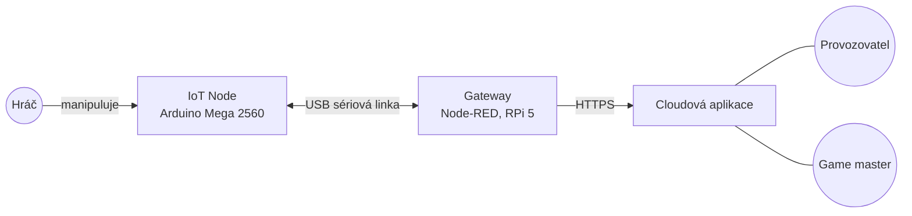
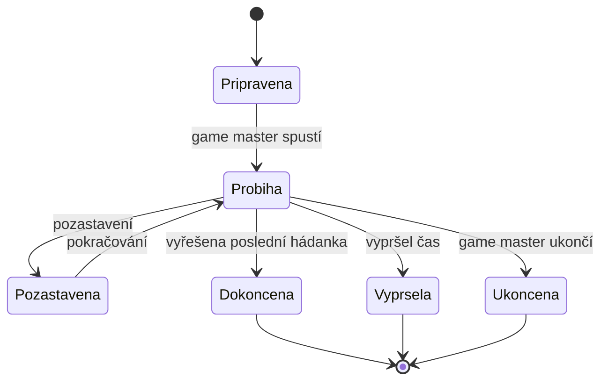
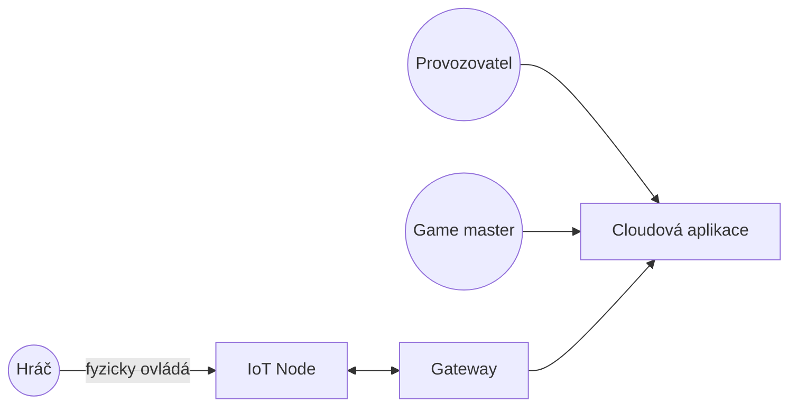
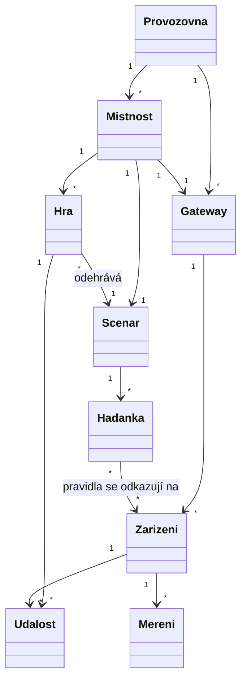

# Business Model

> Struktura souboru odpovídá stránkám dokumentu **BIOT DL Business Model – Tým 1** v uuManagementKitu.
> Každá sekce `## Stránka: …` se kopíruje do stejnojmenné stránky.

---

## Stránka: Main page

### Overview (A4)

**Problém.** Provozovny únikových her dnes stavějí hádanky na míru: každý mechanismus (otevření schránky,
naklonění sošky, stisk tlačítka) vyžaduje vlastní elektroniku a programátora. Změnit hádanku
znamená znovu programovat a game master často nemá přehled, co se v místnosti právě děje
a jestli všechna zařízení fungují.

**Řešení.** Platforma má tři vrstvy:

1. **IoT Node** – Arduino Mega 2560 se senzory (tlačítko, akcelerometr, termistor) a LED, zabudovaný
   v herních předmětech. Sám o sobě o hře nic „neví“, jen hlásí, co se s předměty děje, a vykonává povely.
2. **Gateway** – Raspberry Pi 5 s Node-RED v místnosti, k němuž je node připojen přes USB.
   Stahuje si z cloudu pravidla hádanek a vyhodnocuje je lokálně, takže hráči dostanou okamžitou
   odezvu a hra běží i při výpadku internetu. Data ukládá a odesílá do cloudu.
3. **Cloudová aplikace** – webová aplikace, ve které provozovatel spravuje místnosti a zařízení
   a skládá hádanky z pravidel bez programování. Game master v ní hru spouští, živě sleduje
   a v případě potřeby zasahuje (nápověda, ruční vyřešení, pauza, reset).

**Průběh.** Provozovatel jednou zaregistruje gateway a navrhne scénář. Před hrou game master ověří,
že zařízení jsou online, a resetuje místnost. Během hry gateway vyhodnocuje pravidla a hlásí vyřešené
hádanky do cloudu. Po hře se uloží výsledek a provozovatel vidí statistiky.

**Přínos.** Hádanky lze měnit bez programátora, závady zařízení jsou vidět ještě před hrou,
při výpadku internetu se neztratí žádná data a game master má celou hru pod kontrolou.

### Životní cyklus hry

| Stav | Popis |
|---|---|
| **Připravena** | Místnost je resetovaná, zařízení online, čas neběží. |
| **Probíhá** | Hra je spuštěná, běží čas, gateway vyhodnocuje pravidla. |
| **Pozastavena** | Čas stojí, gateway pravidla nevyhodnocuje; lze pokračovat. |
| **Dokončena** | Hráči vyřešili poslední hádanku. |
| **Vypršela** | Uplynul časový limit scénáře. |
| **Ukončena** | Game master hru předčasně ukončil. |

---

## Stránka: Business actors

| Business Actor | Description |
|---|---|
| **Provozovatel** | Majitel nebo správce provozovny únikových her. Registruje gateway, spravuje místnosti a zařízení, navrhuje hádanky a scénáře, spravuje game mastery a sleduje statistiky. Cíl: rychle stavět a měnit hádanky bez programátora a ladit obtížnost. |
| **Game master** | Zaměstnanec provozovny, který řídí jednotlivé hry: připraví místnost, spustí, pozastaví a ukončí hru, živě ji sleduje a pomáhá hráčům. Cíl: mít přehled o průběhu hry a včas zasáhnout. |
| **Hráč (tým hráčů)** | Zákazník, který hraje hru. S aplikací nepracuje, ovládá jen fyzické předměty a tlačítkem žádá o nápovědu. Cíl: plynulý a zábavný zážitek. |
| **IoT Node** *(systémový aktér)* | Arduino Mega 2560 zabudovaný v herních předmětech. Hlásí stisk tlačítka, pohyb a náklon (akcelerometr) a teplotu, vykonává povely (LED). Cíl: spolehlivě a okamžitě hlásit, co se s předměty děje. |
| **Gateway** *(systémový aktér)* | Node-RED na Raspberry Pi 5 v místnosti. Přijímá data z nodu, vyhodnocuje pravidla hádanek, provádí downsampling teploty, ukládá data a odesílá je do cloudu. Cíl: hra funguje okamžitě i bez internetu a žádná data se neztratí. |

---

## Stránka: Products

### Product Overview

| Produkt | Popis |
|---|---|
| **Provozovna** | Organizace provozovatele; sdružuje místnosti, gateway a uživatele. |
| **Místnost** | Jedna fyzická úniková hra. Má právě jednu gateway, zařízení a scénář. |
| **Gateway** | Registrované zařízení s přístupovým tokenem; patří k jedné provozovně a obsluhuje jednu místnost. |
| **Zařízení** | Senzor (vstup) nebo akční člen (výstup) na IoT nodu se srozumitelným názvem (např. „Víko truhly“). Typ je z pevného katalogu. MVP: tlačítko, akcelerometr, teploměr, LED. |
| **Scénář** | Sada hádanek místnosti a časový limit hry. V MVP jsou hádanky nezávislé, hra je dokončena po vyřešení všech. |
| **Hádanka** | Skupina pravidel **událost → podmínka → akce**, která tvoří jeden úkol (např. „truhla nakloněna > 45° → hádanka vyřešena, rozsviť LED“). |
| **Hra** | Jedno odehrání scénáře týmem hráčů; má stav (viz životní cyklus), čas začátku a konce, počet nápověd a stav jednotlivých hádanek. |
| **Událost** | Záznam ze zařízení nebo od game mastera (stisk, pohyb, vyřešení hádanky, žádost o nápovědu, ruční zásah). |
| **Měření** | Hodnota teploty agregovaná na gateway (downsampling). |

> Statistiky nejsou samostatný produkt – počítají se z produktů Hra, Hádanka a Událost
> (viz **BUC10 Zobrazení statistik**).

---

## Stránka: Business use cases

### BUC List

| ID | Use case | Aktéři | User stories |
|---|---|---|---|
| BUC01 | Registrace gateway | Provozovatel, Gateway | US01 |
| BUC02 | Správa místností a zařízení | Provozovatel | US02, US03 |
| BUC03 | Návrh hádanek a scénáře | Provozovatel | US04, US05, US18, US19 |
| BUC04 | Testování scénáře *(rozšíření)* | Provozovatel, IoT Node, Gateway | US06 |
| BUC05 | Příprava místnosti | Game master | US03, US13, US14 |
| BUC06 | Průběh hry | Game master, Hráč, IoT Node, Gateway | US09–US12, US15, US16 |
| BUC07 | Vyhodnocení hry | Gateway, Game master | US09 |
| BUC08 | Správa uživatelů *(rozšíření)* | Provozovatel | US07 |
| BUC09 | Výpadek připojení | Gateway | US17 |
| BUC10 | Zobrazení statistik *(rozšíření)* | Provozovatel | US08 |

### BUC01 – Registrace gateway
- **Trigger:** Provozovatel instaluje novou gateway do místnosti.
- **Pre-conditions:** Provozovatel má účet a provozovnu; gateway je zapnutá a připojená k internetu.
- **Post-conditions:** Gateway je zaregistrovaná, má přístupový token a smí stahovat pravidla a odesílat data své provozovny.
- **Happy day scenario:**
  1. Provozovatel v aplikaci vytvoří gateway (název, místnost).
  2. Aplikace vygeneruje jednorázový registrační kód.
  3. Technik zadá kód do gateway (dashboard Node-RED).
  4. Gateway se kódem zaregistruje v cloudu a obdrží přístupový token.
  5. Aplikace zobrazí gateway jako online.
- **Alternativy:** neplatný nebo již použitý kód → registrace odmítnuta, provozovatel vygeneruje nový.
- **Mockups:** doplní se v návrhu frontendu (týden 9).
- **Data binding:** zapisuje Gateway; čte Provozovna, Místnost.

### BUC02 – Správa místností a zařízení
- **Trigger:** Provozovatel otevírá novou místnost nebo mění vybavení.
- **Pre-conditions:** Provozovatel má provozovnu; gateway místnosti je zaregistrovaná.
- **Post-conditions:** Místnost má evidovaná a pojmenovaná zařízení, na která se mohou odkazovat pravidla.
- **Happy day scenario:**
  1. Provozovatel vytvoří místnost.
  2. Gateway nahlásí seznam zařízení připojeného nodu (typ z katalogu).
  3. Provozovatel zařízení pojmenuje (např. „Víko truhly“, „Teplota kotle“).
  4. Aplikace zobrazí zařízení místnosti se stavem online/offline a poslední zprávou.
- **Mockups:** doplní se v týdnu 9.
- **Data binding:** zapisuje Místnost, Zařízení; čte Gateway.

### BUC03 – Návrh hádanek a scénáře
- **Trigger:** Provozovatel chce vytvořit nebo změnit hádanku.
- **Pre-conditions:** Místnost má nakonfigurovaná zařízení.
- **Post-conditions:** Místnost má platný scénář; gateway si stáhla aktuální pravidla.
- **Happy day scenario:**
  1. Provozovatel otevře editor pravidel místnosti.
  2. Vytvoří hádanku a složí pravidla: událost zařízení → podmínka (např. náklon > 45°) → akce (hádanka vyřešena, LED).
  3. Nastaví časový limit scénáře a uloží jej.
  4. Aplikace pravidla zvaliduje (odkazují jen na existující zařízení).
  5. Gateway si při další synchronizaci stáhne nová pravidla.
- **Alternativy:** pravidlo odkazuje na neexistující zařízení → aplikace uložení odmítne.
- **Mockups:** doplní se v týdnu 9.
- **Data binding:** zapisuje Scénář, Hádanka; čte Zařízení.

### BUC04 – Testování scénáře *(rozšíření)*
- **Trigger:** Provozovatel dokončil úpravu scénáře.
- **Pre-conditions:** Místnost má scénář, zařízení jsou online.
- **Post-conditions:** Provozovatel ví, že pravidla fungují; testovací data se nezapočítávají do statistik.
- **Happy day scenario:**
  1. Provozovatel spustí testovací režim.
  2. Fyzicky vyzkouší předměty.
  3. Aplikace živě ukazuje, která pravidla se splnila.
  4. Provozovatel test ukončí.
- **Data binding:** zapisuje Hra (příznak test), Událost; čte Scénář, Hádanka.

### BUC05 – Příprava místnosti
- **Trigger:** Blíží se příchod dalšího týmu.
- **Pre-conditions:** Předchozí hra skončila; uživatel má roli game master pro místnost.
- **Post-conditions:** Místnost je ve výchozím stavu, nová hra je ve stavu **Připravena**.
- **Happy day scenario:**
  1. Game master otevře přehled místnosti.
  2. Zkontroluje, že všechna zařízení jsou online.
  3. Zvolí „Reset místnosti“.
  4. Gateway vrátí stav hádanek i výstupy (LED) do výchozího stavu.
  5. Aplikace vytvoří novou hru ve stavu Připravena.
- **Alternativy:** zařízení offline → aplikace ho zvýrazní, game master závadu řeší před hrou.
- **Data binding:** zapisuje Hra; čte Zařízení, Scénář.

### BUC06 – Průběh hry
- **Trigger:** Game master spustí hru.
- **Pre-conditions:** Hra je ve stavu Připravena.
- **Post-conditions:** Hra skončila ve stavu Dokončena, Vypršela nebo Ukončena.
- **Happy day scenario:**
  1. Game master spustí hru, začne běžet čas.
  2. Hráči manipulují s předměty, IoT node hlásí události gateway.
  3. Gateway vyhodnocuje pravidla (jen během aktivní hry), při splnění označí hádanku za vyřešenou a pošle povel nodu (LED).
  4. Gateway odešle událost do cloudu, game master vidí stav hádanek živě.
  5. Hráč stiskne tlačítko nápovědy, game master dostane upozornění a nápovědu poskytne.
  6. Po vyřešení poslední hádanky přejde hra do stavu Dokončena.
- **Alternativy:**
  - game master hru pozastaví a později obnoví,
  - zařízení selže → game master ručně označí hádanku za vyřešenou (nebo ji vrátí),
  - vyprší čas → stav Vypršela, game master dostane upozornění,
  - game master hru předčasně ukončí → stav Ukončena.
- **Data binding:** zapisuje Hra, Událost; čte Scénář, Hádanka, Zařízení.

### BUC07 – Vyhodnocení hry
- **Trigger:** Hra skončila.
- **Pre-conditions:** Hra je ve stavu Dokončena, Vypršela nebo Ukončena.
- **Post-conditions:** Výsledek hry je uložen.
- **Happy day scenario:**
  1. Aplikace uloží čas konce, celkovou dobu, počet nápověd a časy vyřešení jednotlivých hádanek.
  2. Game master vidí shrnutí hry.
- **Data binding:** zapisuje Hra; čte Událost.

### BUC08 – Správa uživatelů *(rozšíření)*
- **Trigger:** Provozovna přijme nového game mastera.
- **Pre-conditions:** Provozovatel má provozovnu a místnosti.
- **Post-conditions:** Game master má přístup jen k přiděleným místnostem.
- **Happy day scenario:**
  1. Provozovatel přidá uživatele s rolí game master.
  2. Přidělí mu místnosti.
  3. Game master se přihlásí a vidí jen své místnosti.
- **Data binding:** zapisuje uživatele a jejich přiřazení k Místnosti.

### BUC09 – Výpadek připojení
- **Trigger:** Gateway ztratí připojení k internetu.
- **Pre-conditions:** Gateway má stažená pravidla aktuálního scénáře.
- **Post-conditions:** Po obnovení připojení jsou všechna data v cloudu, žádná se neztratila.
- **Happy day scenario:**
  1. Gateway zjistí, že cloud je nedostupný.
  2. Dál vyhodnocuje pravidla lokálně, hra pokračuje bez přerušení.
  3. Události a měření ukládá do perzistentní fronty (neodeslaná data drží neomezeně).
  4. Po obnovení připojení frontu odešle ve správném pořadí.
  5. Odeslaná data smaže po uplynutí retence (24 h).
- **Data binding:** zapisuje Událost, Měření.

### BUC10 – Zobrazení statistik *(rozšíření)*
- **Trigger:** Provozovatel chce vyhodnotit obtížnost místnosti.
- **Pre-conditions:** V místnosti už proběhly hry.
- **Post-conditions:** Provozovatel vidí statistiky; žádná data se nemění.
- **Happy day scenario:**
  1. Provozovatel otevře statistiky místnosti a zvolí období.
  2. Aplikace spočítá z odehraných her průměrný čas, podíl dokončených her, průměrný počet nápověd a nejdéle řešené hádanky.
  3. Aplikace statistiky zobrazí.
- **Data binding:** jen čte Hra, Hádanka, Událost (testovací hry vynechává).
