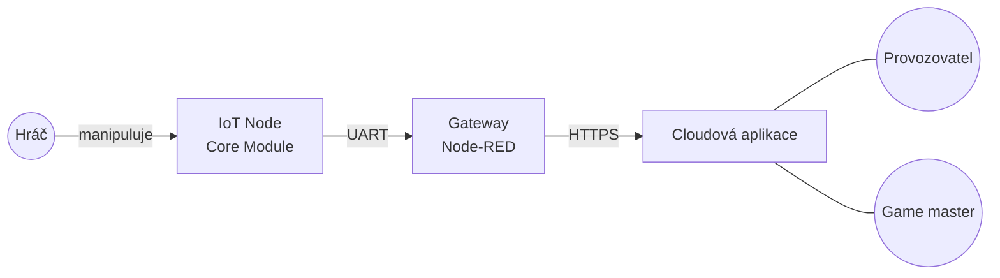
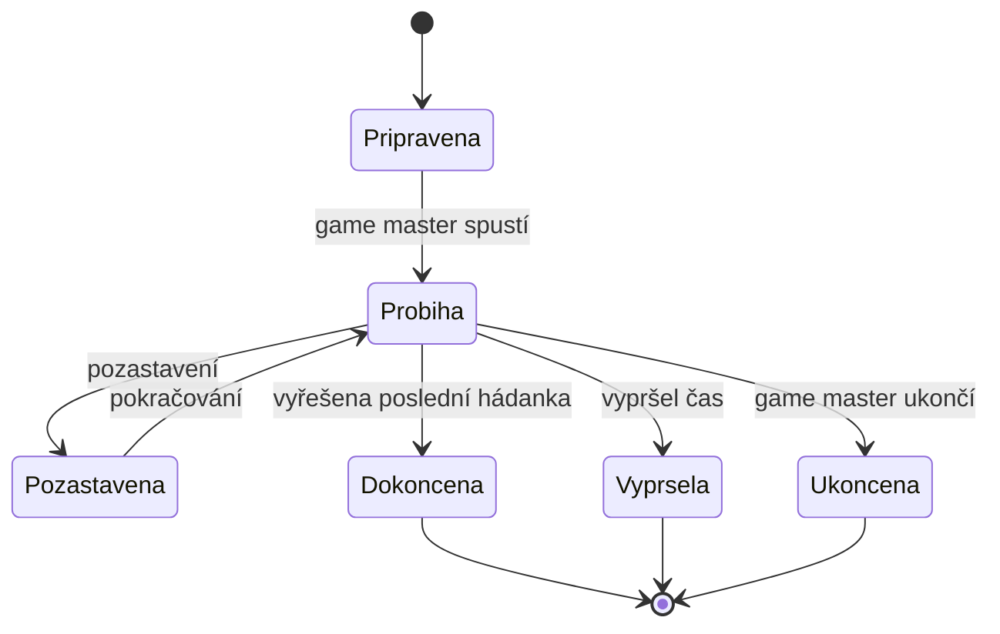

# Business Model

## Overview (A4)

Provozovny únikových her dnes stavějí hádanky na míru: každý mechanismus (otevření schránky,
naklonění sošky, stisk tlačítka) vyžaduje vlastní elektroniku a programátora. Změnit hádanku
znamená znovu programovat a game master často nemá přehled, co se v místnosti právě děje.

Naše platforma tento problém řeší třemi vrstvami:

1. **Zařízení v místnosti (IoT Node)** – univerzální modul HARDWARIO Core Module s tlačítkem,
   akcelerometrem a teploměrem, který se zabuduje do herního předmětu. Sám o sobě nic „neví“,
   jen hlásí, co se s ním děje (stisk, pohyb, naklonění, teplota).
2. **Gateway v provozovně** – Raspberry Pi s Node-RED, ke kterému jsou zařízení připojena.
   Stahuje si z cloudu pravidla hádanek a vyhodnocuje je lokálně, takže hráči dostanou okamžitou
   odezvu a hra běží i při výpadku internetu. Události a měření posílá do cloudu.
3. **Cloudová aplikace** – webová aplikace, ve které provozovatel skládá hádanky z pravidel
   „když – pak“ bez programování, spravuje místnosti a zařízení. Game master v ní spouští hru,
   živě sleduje stav hádanek a v případě potřeby zasahuje (nápověda, ruční vyřešení, reset).

Hodnota pro provozovatele: hádanky lze měnit a přidávat bez programátora, závady zařízení jsou
vidět ještě před hrou a game master má celou hru pod kontrolou na jedné obrazovce.

## Business aktéři

| Aktér | Typ | Popis | Cíle |
|---|---|---|---|
| **Provozovatel** | člověk | Majitel nebo správce provozovny únikových her. | Rychle stavět a měnit hádanky, mít funkční zařízení, ladit obtížnost. |
| **Game master** | člověk | Zaměstnanec, který řídí a sleduje jednotlivé hry. | Mít přehled o průběhu hry, včas pomoct hráčům, rychle připravit místnost. |
| **Hráč (tým hráčů)** | člověk | Zákazník, který hraje hru. S aplikací nepracuje, ovládá jen fyzické předměty. | Plynulý a zábavný zážitek, nápověda, když uvízne. |
| **IoT Node** | systém | HARDWARIO Core Module zabudovaný v herním předmětu. | Spolehlivě hlásit stisk, pohyb a teplotu. |
| **Gateway** | systém | Node-RED na Raspberry Pi v provozovně. | Vyhodnotit pravidla, uchovat a odeslat data do cloudu. |

## Business produkty

| Produkt | Popis |
|---|---|
| **Provozovna** | Organizace provozovatele; sdružuje místnosti, gateway a uživatele. |
| **Gateway** | Registrované zařízení provozovny s přístupovým tokenem; patří k jedné provozovně. |
| **Zařízení (IoT Node)** | Konkrétní modul v herním předmětu (např. „Truhla“, „Soška“); patří k jedné gateway a jedné místnosti. |
| **Místnost** | Herní místnost se zařízeními a scénářem. |
| **Hádanka** | Pravidlo „když – pak“: podmínka nad událostí zařízení (stisk, náklon > X°, teplota > Y °C) a výsledek (hádanka vyřešena, rozsvícení LED). |
| **Scénář** | Seřazená sada hádanek místnosti včetně závislostí (B až po A) a časového limitu. |
| **Hra** | Konkrétní odehrání scénáře jedním týmem; má stav, čas startu a konce, počet nápověd. |
| **Událost** | Záznam ze zařízení nebo od game mastera (stisk, pohyb, hádanka vyřešena, žádost o nápovědu, ruční zásah). |
| **Měření** | Agregovaná hodnota teploty po downsamplingu na gateway. |
| **Statistika** | Souhrn odehraných her (průměrný čas, nápovědy, nejtěžší hádanky). |

### Životní cyklus hry

## Business use-cases

| ID | Use-case | Aktéři | Popis | Výsledek | User stories |
|---|---|---|---|---|---|
| BUC01 | **Registrace gateway** | Provozovatel, Gateway | Provozovatel v aplikaci vytvoří gateway a získá registrační kód. Gateway se kódem zaregistruje a dostane přístupový token. | Gateway smí posílat data do cloudu. | US01 |
| BUC02 | **Správa místností a zařízení** | Provozovatel | Provozovatel vytvoří místnost, pojmenuje zařízení připojená ke gateway a přiřadí je místnosti. | Místnost má evidovaná zařízení. | US02, US03 |
| BUC03 | **Návrh hádanek a scénáře** | Provozovatel | Provozovatel skládá hádanky z pravidel „když – pak“, řadí je do scénáře a nastaví časový limit. Gateway si pravidla stáhne. | Místnost má platný scénář. | US04, US05 |
| BUC04 | **Testování scénáře** | Provozovatel, IoT Node, Gateway | Provozovatel spustí testovací režim a fyzicky vyzkouší zařízení; aplikace ukazuje, která pravidla se splnila. Data se nezapočítávají do statistik. | Ověřený scénář. | US06 |
| BUC05 | **Příprava místnosti** | Game master | Game master zkontroluje, že jsou všechna zařízení online, a resetuje místnost do výchozího stavu. | Místnost připravená pro tým. | US03, US13, US14 |
| BUC06 | **Průběh hry** | Game master, Hráč, IoT Node, Gateway | Game master spustí hru. Hráči manipulují s předměty, gateway vyhodnocuje pravidla a hlásí vyřešené hádanky. Game master sleduje stav živě, odpovídá na žádosti o nápovědu, může hádanku ručně vyřešit nebo vrátit a hru pozastavit. | Hra skončí vyřešením, vypršením času nebo ukončením. | US09–US12, US15, US16 |
| BUC07 | **Vyhodnocení hry** | Game master, Provozovatel | Po skončení se uloží výsledek (čas, nápovědy, časy jednotlivých hádanek); provozovatel vidí statistiky. | Uložený výsledek a statistiky. | US08 |
| BUC08 | **Správa uživatelů** | Provozovatel | Provozovatel přidá game mastera a přidělí mu místnosti. | Game master má přístup ke svým místnostem. | US07 |
| BUC09 | **Výpadek připojení** | Gateway | Při výpadku internetu gateway dál vyhodnocuje pravidla, data ukládá lokálně a po obnovení připojení je odešle. | Žádná data ze hry se neztratí. | US17 |
