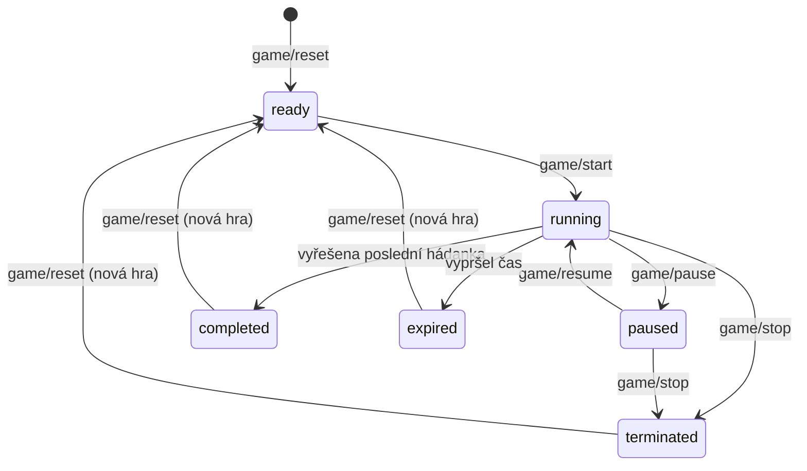

# Command List – webová aplikace

> Zdroj pro stránku **BIOT DL Application Model – Tým 1 → Command List** (část webové aplikace).
> Kdo smí který command volat, je shrnuto v [`application-profiles.md`](application-profiles.md).

Rozsah odpovídá **MVP** (US02–US04, US09–US14). Commandy pro rozšíření jsou jen vyjmenované
v [kapitole 9](#9-rozšíření-mimo-mvp).

## Přehled commandů

| Oblast | Commandy | Use case |
|---|---|---|
| Místnost | `room/create`, `room/get`, `room/list`, `room/update`, `room/delete` | BUC02 |
| Zařízení | `device/list`, `device/update` | BUC02 |
| Scénář | `scenario/get`, `scenario/update` | BUC03 |
| Hádanka | `puzzle/create`, `puzzle/update`, `puzzle/delete` | BUC03 |
| Řízení hry | `game/reset`, `game/start`, `game/pause`, `game/resume`, `game/stop`, `game/solvePuzzle`, `game/unsolvePuzzle` | BUC05, BUC06 |
| Živý přehled | `game/getCurrent` | BUC06 |

Celkem **20 commandů**.

---

## 1. Konvence

### Endpointy

- Styl uuApp: `POST /<entita>/<akce>` pro commandy, které mění data, `GET /<entita>/<akce>` pro čtení.
- U `POST` je dtoIn v těle požadavku (JSON), u `GET` v query stringu (`GET /room/get?id=…`).
- Pouze HTTPS, každý požadavek nese `Authorization: Bearer <token>` (viz Application Profiles).

### dtoIn a dtoOut

- **dtoIn** je vstup commandu. Validuje se proti schématu v typovém zápisu uuApp,
  např. `shape({ name: string(1, 100).isRequired() })`. Neznámé klíče se zahodí a vrátí se varování `unsupportedKeys`.
- **dtoOut** je výstup commandu. Vždy obsahuje `uuAppErrorMap` s varováními (při selhání i s chybou).
- `venueId` (provozovna) **nikdy není v dtoIn**: server ho bere z tokenu volajícího.
- Id jsou MongoDB ObjectId (`id()`), časy jsou ISO 8601 v UTC.
- Každý uložený objekt má navíc `id`, `createdAt`, `updatedAt` (níže se neopakují).

### Chyby

Kód chyby má tvar `escape-room-iot/<command>/<nazevChyby>`, např. `escape-room-iot/room/create/invalidDtoIn`.

```json
{
  "uuAppErrorMap": {
    "escape-room-iot/room/create/invalidDtoIn": {
      "type": "error",
      "message": "DtoIn is not valid.",
      "paramMap": { "invalidValueKeyMap": { "$.name": "string too long" } }
    }
  }
}
```

Chyby, které může vrátit každý command (u jednotlivých commandů se neopakují):

| Kód | Typ | HTTP | Kdy |
|---|---|---|---|
| `unsupportedKeys` | varování | – | dtoIn obsahuje klíče mimo schéma, ignorují se |
| `invalidDtoIn` | chyba | 400 | dtoIn neodpovídá schématu |
| `userNotAuthenticated` | chyba | 401 | chybí nebo je neplatný token |
| `userNotAuthorized` | chyba | 403 | profil volajícího tento command volat nesmí |
| `<entita>DoesNotExist` | chyba | 404 | objekt neexistuje **nebo patří jiné provozovně** |

Specifické chyby: **400** (neplatný obsah), **404** (odkazovaný objekt neexistuje),
**409** (objekt je ve stavu, který operaci nedovolí).

---

## 2. Datový model

> Kolekce, atributy, indexy a retence jsou v [`persistence-layer.md`](persistence-layer.md).

**Stavy hry** (životní cyklus z Business Modelu → hodnota v kódu):

| Business Model | `game.state` |
|---|---|
| Připravena | `ready` |
| Probíhá | `running` |
| Pozastavena | `paused` |
| Dokončena | `completed` |
| Vypršela | `expired` |
| Ukončena | `terminated` |

**Typy zařízení** (pevný katalog MVP):

| `type` | Druh | Události |
|---|---|---|
| `button` | vstup | `press` |
| `accelerometer` | vstup | `tilt` (úhel 0–180 °), `move` |
| `thermometer` | vstup | `temperature` (°C): vyhodnocuje se jen na gateway, do cloudu jde po downsamplingu jako `measurement`, ne jako událost |
| `led` | výstup | přijímá akci `setLed` |

**Limity použité ve validaci** jsou v [Limit Listu](persistence-layer.md#limit-list): místností na provozovnu 50,
hádanek ve scénáři 50, pravidel v hádance 10, akcí v pravidle 5, `timeLimitMin` 5–240 min.

---

## 3. Místnost

Místnost je jedna fyzická úniková hra. Při vytvoření se k ní automaticky založí scénář.

### room/create

**Metoda:** `POST /room/create` · **Profily:** Operators · **Use case:** BUC02, US02

```js
const roomCreateDtoInType = shape({
  name:         string(1, 100).isRequired(),
  description:  string(0, 1000),
  timeLimitMin: integer(5, 240)      // výchozí 60, zapíše se do nového scénáře
});
```

**dtoOut**

```json
{
  "id": "6543a1...", "name": "Pirátská kajuta", "description": "",
  "gateway": null, "currentGameId": null,
  "uuAppErrorMap": {}
}
```

**Kroky**

1. Zvaliduje dtoIn.
2. Ověří, že provozovna má méně než 50 místností, jinak `roomLimitExceeded`.
3. Ověří, že v provozovně není místnost se stejným názvem, jinak `roomNameAlreadyExists`.
4. Vytvoří místnost a k ní scénář (`timeLimitMin`, `hintDeviceId: null`, `revision: 1`).
5. Vrátí místnost.

| Chyba | Typ | HTTP | Popis |
|---|---|---|---|
| `roomLimitExceeded` | chyba | 409 | Provozovna má maximální počet místností. |
| `roomNameAlreadyExists` | chyba | 409 | Místnost s tímto názvem už existuje. |

### room/get

**Metoda:** `GET /room/get` · **Profily:** Operators, GameMasters · **Use case:** BUC02, BUC05

```js
const roomGetDtoInType = shape({ id: id().isRequired() });
```

**dtoOut:** místnost a krátký přehled pro detail místnosti.

```json
{
  "id": "...", "name": "Pirátská kajuta", "description": "", "currentGameId": "...",
  "gateway": { "id": "...", "name": "RPi Pirát", "online": true, "lastSeenAt": "..." },
  "deviceSummary": { "total": 4, "online": 4, "offline": 0 },
  "currentGameState": "ready",
  "uuAppErrorMap": {}
}
```

`online` znamená, že `lastSeenAt` není starší než 60 s (2× navrhovaný heartbeat 30 s, domluvit s Davidem).

### room/list

**Metoda:** `GET /room/list` · **Profily:** Operators, GameMasters · **Use case:** BUC02, BUC05, US03

```js
const roomListDtoInType = shape({
  pageInfo: shape({ pageIndex: integer(0, null), pageSize: integer(1, 100) })  // výchozí 0 a 50
});
```

**dtoOut:** `itemList` místností ve stejném tvaru jako `room/get`, seřazené podle názvu,
a `pageInfo: { pageIndex, pageSize, total }`. Provozovatel tu na jednom místě vidí stav všech místností a zařízení (US03).

### room/update

**Metoda:** `POST /room/update` · **Profily:** Operators · **Use case:** BUC02

```js
const roomUpdateDtoInType = shape({
  id:          id().isRequired(),
  name:        string(1, 100),
  description: string(0, 1000)
});
```

**dtoOut:** upravená místnost. **Chyby:** `roomNameAlreadyExists` (409), pokud se mění název na už použitý.

### room/delete

**Metoda:** `POST /room/delete` · **Profily:** Operators · **Use case:** BUC02

```js
const roomDeleteDtoInType = shape({ id: id().isRequired() });
```

**dtoOut:** `{ "uuAppErrorMap": {} }`

**Kroky**

1. Zvaliduje dtoIn a načte místnost.
2. Pokud má místnost gateway, vrátí `roomHasGateway`: gateway se musí smazat dřív, aby neposílala data do smazané místnosti.
3. Pokud hra právě běží nebo je pozastavená, vrátí `gameInProgress`.
4. Smaže místnost a vše, co k ní patří (scénář, hádanky, zařízení, hry, události).

| Chyba | Typ | HTTP | Popis |
|---|---|---|---|
| `roomHasGateway` | chyba | 409 | Nejdřív je potřeba smazat gateway místnosti. |
| `gameInProgress` | chyba | 409 | V místnosti probíhá nebo je pozastavená hra. |

---

## 4. Zařízení

Zařízení **zakládá gateway**: nahlásí zařízení připojeného nodu (BUC02 krok 2, Davidova část).
Provozovatel je jen srozumitelně pojmenuje.

### device/list

**Metoda:** `GET /device/list` · **Profily:** Operators, GameMasters · **Use case:** BUC02, BUC05, US03

```js
const deviceListDtoInType = shape({ roomId: id().isRequired() });
```

**dtoOut**

```json
{
  "itemList": [
    { "id": "...", "hwId": "acc1", "type": "accelerometer", "name": "Víko truhly",
      "online": true, "lastSeenAt": "2026-11-03T10:05:12Z",
      "lastValue": { "event": "tilt", "value": 12 } }
  ],
  "uuAppErrorMap": {}
}
```

Bez stránkování, místnost má nejvýš 32 zařízení. **Chyby:** `roomDoesNotExist`.

### device/update

**Metoda:** `POST /device/update` · **Profily:** Operators · **Use case:** BUC02 krok 3

```js
const deviceUpdateDtoInType = shape({
  id:   id().isRequired(),
  name: string(1, 100).isRequired()
});
```

**dtoOut:** upravené zařízení. Atributy `type` a `hwId` měnit nejdou, protože jsou dané hardwarem.

| Chyba | Typ | HTTP | Popis |
|---|---|---|---|
| `deviceNameAlreadyExists` | chyba | 409 | Jiné zařízení v místnosti už má stejný název. |

---

## 5. Scénář a hádanky

Každá místnost má právě jeden scénář: sadu hádanek a časový limit hry. V MVP jsou hádanky nezávislé
a hra je dokončená, když jsou vyřešené všechny.

**Revize scénáře.** Každá změna scénáře nebo hádanky zvýší `scenario.revision`. Gateway porovná revizi se svou,
a když se liší, stáhne si nová pravidla (Davidův command pro konfiguraci).

**Změny během hry jsou zakázané.** Když hra běží nebo je pozastavená, commandy `scenario/update`
a `puzzle/*` vrátí `gameInProgress` (409). Gateway vyhodnocuje pevnou sadu pravidel, takže změna uprostřed hry by zmátla hráče.

### Pravidlo „když – pak“

Hádanka je skupina pravidel **událost zařízení → podmínka → akce**. Hádanka je vyřešená, jakmile se splní
kterékoli její pravidlo s akcí `solvePuzzle`. Pravidla vyhodnocuje **gateway**, cloud je jen ukládá a validuje.

```js
const ruleType = shape({
  trigger: shape({
    deviceId:  id().isRequired(),
    eventType: oneOf(["press", "tilt", "move", "temperature"]).isRequired()
  }).isRequired(),
  condition: shape({                       // povinná u "tilt" a "temperature", jinde zakázaná
    operator: oneOf(["gt", "gte", "lt", "lte"]).isRequired(),
    value:    number().isRequired()        // stupně u tilt, °C u temperature
  }),
  actionList: array(shape({
    type:     oneOf(["solvePuzzle", "setLed"]).isRequired(),
    deviceId: id(),                        // povinné u setLed
    state:    oneOf(["on", "off", "blink"])  // povinné u setLed
  }), 1, 5).isRequired()
});
```

Příklad: *„když se truhla nakloní o víc než 45°, hádanka je vyřešena a rozsvítí se zelená LED“*.

```json
{
  "trigger":    { "deviceId": "<akcelerometr truhly>", "eventType": "tilt" },
  "condition":  { "operator": "gt", "value": 45 },
  "actionList": [
    { "type": "solvePuzzle" },
    { "type": "setLed", "deviceId": "<zelená LED>", "state": "on" }
  ]
}
```

**Validace pravidel** (společná pro `puzzle/create` a `puzzle/update`):

| # | Kontrola | Chyba |
|---|---|---|
| 1 | každé `deviceId` je zařízení **stejné místnosti** | `deviceDoesNotExist` (404) |
| 2 | spouštěcí zařízení je vstup a podporuje `eventType` (viz katalog typů) | `eventTypeNotSupported` (400) |
| 3 | `condition` je vyplněná právě u `tilt` a `temperature` | `invalidCondition` (400) |
| 4 | `setLed` míří na zařízení typu `led` a má `state` | `deviceTypeMismatch` (400) |
| 5 | aspoň jedno pravidlo hádanky obsahuje `solvePuzzle`, jinak by nešla vyřešit | `puzzleCannotBeSolved` (400) |

### scenario/get

**Metoda:** `GET /scenario/get` · **Profily:** Operators, GameMasters · **Use case:** BUC03

```js
const scenarioGetDtoInType = shape({ roomId: id().isRequired() });
```

**dtoOut:** scénář včetně všech hádanek, protože editor pravidel je potřebuje najednou. Proto neexistuje `puzzle/list`.

```json
{
  "id": "...", "roomId": "...", "timeLimitMin": 60, "hintDeviceId": "...", "revision": 7,
  "puzzleList": [
    { "id": "...", "name": "Otevři truhlu", "description": "", "order": 1, "ruleList": [ ] }
  ],
  "uuAppErrorMap": {}
}
```

### scenario/update

**Metoda:** `POST /scenario/update` · **Profily:** Operators · **Use case:** BUC03, US16

```js
const scenarioUpdateDtoInType = shape({
  roomId:       id().isRequired(),
  timeLimitMin: integer(5, 240),
  hintDeviceId: id()             // tlačítko, kterým hráči žádají o nápovědu (US16)
});
```

**dtoOut:** scénář jako u `scenario/get`.

**Kroky:** zvaliduje dtoIn, zkontroluje `gameInProgress`, ověří, že `hintDeviceId` je tlačítko
ve stejné místnosti (`deviceDoesNotExist`, `deviceTypeMismatch`), uloží a zvýší `revision`.

### puzzle/create

**Metoda:** `POST /puzzle/create` · **Profily:** Operators · **Use case:** BUC03, US04

```js
const puzzleCreateDtoInType = shape({
  roomId:      id().isRequired(),
  name:        string(1, 100).isRequired(),
  description: string(0, 2000),          // poznámka pro game mastera, např. řešení
  order:       integer(1, 50),           // pořadí zobrazení, výchozí = poslední
  ruleList:    array(ruleType, 1, 10).isRequired()
});
```

**dtoOut:** vytvořená hádanka `{ id, roomId, name, description, order, ruleList, uuAppErrorMap }`.

**Kroky**

1. Zvaliduje dtoIn a načte místnost.
2. Zkontroluje `gameInProgress`.
3. Ověří limit 50 hádanek, jinak `puzzleLimitExceeded` (409).
4. Provede validaci pravidel.
5. Uloží hádanku a zvýší `scenario.revision`.

### puzzle/update

**Metoda:** `POST /puzzle/update` · **Profily:** Operators · **Use case:** BUC03, US04

```js
const puzzleUpdateDtoInType = shape({
  id:          id().isRequired(),
  name:        string(1, 100),
  description: string(0, 2000),
  order:       integer(1, 50),
  ruleList:    array(ruleType, 1, 10)    // nahradí celý seznam pravidel
});
```

**dtoOut:** upravená hádanka. **Kroky a chyby** jako u `puzzle/create` (bez kontroly limitu).

### puzzle/delete

**Metoda:** `POST /puzzle/delete` · **Profily:** Operators · **Use case:** BUC03

```js
const puzzleDeleteDtoInType = shape({ id: id().isRequired() });
```

**dtoOut:** `{ "uuAppErrorMap": {} }`. Zkontroluje `gameInProgress`, smaže hádanku a zvýší `scenario.revision`.
Odehrané hry si drží vlastní kopii názvů hádanek (`puzzleStateList`), takže jejich historie zůstane čitelná.

---

## 6. Řízení hry

Commandy pracují s **aktuální hrou místnosti** (`room.currentGameId`), proto mají na vstupu `roomId`.
Game master pracuje s místností a nehrozí, že by omylem ovládal starou hru.

Každý řídicí command:

1. změní hru v cloudu,
2. zapíše **událost** (`source: "user"`), která se ukáže v živém přehledu,
3. vloží **povel pro gateway** do fronty `gatewayCommand` (viz [kapitola 8](#8-rozhraní-ke-gateway)).
   Když je gateway offline, povel ve frontě počká a dtoOut obsahuje varování `gatewayOffline`.



**dtoOut hry** (vrací ho všechny řídicí commandy):

```json
{
  "id": "...", "roomId": "...", "state": "running", "timeLimitMin": 60,
  "startedAt": "2026-11-03T18:00:00Z", "pausedAt": null, "pausedDurationSec": 120, "endedAt": null,
  "elapsedSec": 1500, "remainingSec": 2100,
  "hintCount": 1,
  "puzzleStateList": [
    { "puzzleId": "...", "name": "Otevři truhlu", "state": "solved",
      "solvedAt": "2026-11-03T18:12:40Z", "solvedBy": "gateway" },
    { "puzzleId": "...", "name": "Ohřej kotel", "state": "unsolved", "solvedAt": null, "solvedBy": null }
  ],
  "uuAppErrorMap": {}
}
```

- `elapsedSec` = (teď, nebo `pausedAt` při pauze, nebo `endedAt` po konci) − `startedAt` − `pausedDurationSec`.
- `remainingSec` = `timeLimitMin × 60` − `elapsedSec` (nejméně 0). Obě hodnoty se počítají, neukládají.
- `solvedBy`: `gateway` (splnilo se pravidlo) nebo `user` (ruční vyřešení).

Chyby společné pro řízení hry:

| Chyba | Typ | HTTP | Popis |
|---|---|---|---|
| `gameDoesNotExist` | chyba | 404 | Místnost nemá aktuální hru, nejdřív je potřeba zavolat `game/reset`. |
| `invalidGameState` | chyba | 409 | V tomto stavu hry operace není povolená. `paramMap.state`, `paramMap.allowedStateList` |
| `gatewayOffline` | varování | – | Gateway je offline, povel se doručí po jejím připojení. |

| Command | Povolený stav hry | Nový stav | Událost | Povel pro gateway |
|---|---|---|---|---|
| `game/reset` | žádná hra, `ready`, `completed`, `expired`, `terminated` | `ready` (nová hra) | `roomReset` | `resetRoom` |
| `game/start` | `ready` | `running` | `gameStarted` | `startGame` |
| `game/pause` | `running` | `paused` | `gamePaused` | `pauseGame` |
| `game/resume` | `paused` | `running` | `gameResumed` | `resumeGame` |
| `game/stop` | `running`, `paused` | `terminated` | `gameTerminated` | `stopGame` |
| `game/solvePuzzle` | `running`, `paused` | beze změny, nebo `completed` | `puzzleSolvedManually` | `solvePuzzle` |
| `game/unsolvePuzzle` | `running`, `paused` | beze změny | `puzzleUnsolved` | `unsolvePuzzle` |

### game/reset

**Metoda:** `POST /game/reset` · **Profily:** Operators, GameMasters · **Use case:** BUC05, US14

Připraví místnost pro další skupinu: založí novou hru ve stavu `ready` a gateway vrátí hádanky
i výstupy (LED) do výchozího stavu.

```js
const gameResetDtoInType = shape({ roomId: id().isRequired() });
```

**dtoOut:** nová hra.

**Kroky**

1. Zvaliduje dtoIn a načte místnost.
2. Pokud hra běží nebo je pozastavená, vrátí `invalidGameState` (hru je nejdřív potřeba ukončit).
3. Pokud scénář nemá žádné hádanky, vrátí `scenarioHasNoPuzzles` (409).
4. Je-li aktuální hra už `ready`, ponechá ji a jen znovu pošle reset na gateway.
   Jinak založí novou hru: `state: "ready"`, `timeLimitMin` a `scenarioRevision` ze scénáře,
   všechny hádanky `unsolved`, `hintCount: 0`. Nastaví `room.currentGameId`.
5. Zapíše událost a vloží povel pro gateway.
6. Jsou-li některá zařízení offline, vrátí varování `devicesOffline` s jejich seznamem (alternativa BUC05).

### game/start

**Metoda:** `POST /game/start` · **Profily:** Operators, GameMasters · **Use case:** BUC06, US09

```js
const gameStartDtoInType = shape({ roomId: id().isRequired() });
```

**dtoOut:** hra.

**Kroky**

1. Zvaliduje dtoIn, načte místnost a aktuální hru, ověří stav `ready`.
2. Gateway musí být online, jinak **chyba** `gatewayOffline` (409). Pravidla vyhodnocuje gateway,
   takže hra, o které neví, by nefungovala.
3. Pokud se scénář od resetu změnil (`scenario.revision ≠ game.scenarioRevision`), vrátí `scenarioChanged` (409)
   a game master musí místnost resetovat znovu.
4. Nastaví `state: "running"`, `startedAt: teď`, zapíše událost a vloží povel.

### game/pause

**Metoda:** `POST /game/pause` · **Profily:** Operators, GameMasters · **Use case:** BUC06, US09

```js
const gamePauseDtoInType = shape({ roomId: id().isRequired() });
```

Nastaví `state: "paused"`, `pausedAt: teď`. Gateway přestane vyhodnocovat pravidla a čas stojí.

### game/resume

**Metoda:** `POST /game/resume` · **Profily:** Operators, GameMasters · **Use case:** BUC06, US09

```js
const gameResumeDtoInType = shape({ roomId: id().isRequired() });
```

Přičte dobu pauzy (`pausedDurationSec += teď − pausedAt`), nastaví `pausedAt: null` a `state: "running"`.

### game/stop

**Metoda:** `POST /game/stop` · **Profily:** Operators, GameMasters · **Use case:** BUC06, BUC07, US09

Předčasně ukončí hru (stav *Ukončena*).

```js
const gameStopDtoInType = shape({
  roomId: id().isRequired(),
  reason: string(0, 500)           // nepovinná poznámka, např. „hráči odešli“
});
```

Je-li hra pozastavená, nejdřív přičte dobu pauzy. Pak nastaví `state: "terminated"`, `endedAt: teď`.

### game/solvePuzzle

**Metoda:** `POST /game/solvePuzzle` · **Profily:** Operators, GameMasters · **Use case:** BUC06, US11

Ručně označí hádanku za vyřešenou, např. když selže zařízení.

```js
const gameSolvePuzzleDtoInType = shape({
  roomId:     id().isRequired(),
  puzzleId:   id().isRequired(),
  runActions: boolean()            // výchozí true: gateway provede i akce hádanky (např. rozsvítí LED)
});
```

**Kroky**

1. Zvaliduje dtoIn a ověří stav hry.
2. Hádanka musí být součástí hry, jinak `puzzleNotInGame` (404), a nesmí být vyřešená, jinak `puzzleAlreadySolved` (409).
3. Nastaví `state: "solved"`, `solvedAt: teď`, `solvedBy: "user"`, zapíše událost a vloží povel.
4. Jsou-li vyřešené všechny hádanky, nastaví hře `state: "completed"` a `endedAt: teď`.

### game/unsolvePuzzle

**Metoda:** `POST /game/unsolvePuzzle` · **Profily:** Operators, GameMasters · **Use case:** BUC06, US11

Vrátí hádanku mezi nevyřešené, např. když se zařízení spustilo omylem.

```js
const gameUnsolvePuzzleDtoInType = shape({
  roomId:   id().isRequired(),
  puzzleId: id().isRequired()
});
```

Hádanka musí být vyřešená, jinak `puzzleNotSolved` (409). Nastaví `state: "unsolved"`, `solvedAt` a `solvedBy` na `null`.
Dokončenou hru už znovu otevřít nejde, protože skončila.

---

## 7. Živý přehled

### game/getCurrent

**Metoda:** `GET /game/getCurrent` · **Profily:** Operators, GameMasters · **Use case:** BUC06, US10, US12

Obrazovka game mastera tento command volá **každé 2 sekundy** (polling). Jedním voláním dostane stav hry,
upozornění a poslední události.

```js
const gameGetCurrentDtoInType = shape({
  roomId:      id().isRequired(),
  eventsSince: datetime()          // jen události PŘIJATÉ cloudem po tomto čase (createdAt); bez něj posledních 20
});
```

**dtoOut**

```json
{
  "game": { "...": "hra jako v kapitole 6" },
  "alertList": [
    { "type": "hintRequested", "at": "2026-11-03T18:20:00Z" },
    { "type": "timeExpired", "at": "2026-11-03T19:02:00Z" },
    { "type": "deviceOffline", "deviceId": "...", "since": "2026-11-03T18:30:00Z" }
  ],
  "eventList": [
    { "type": "deviceEvent", "deviceName": "Víko truhly", "value": { "event": "tilt", "value": 52 },
      "source": "gateway", "occurredAt": "...", "createdAt": "..." },
    { "type": "puzzleSolved", "puzzleId": "...", "source": "gateway", "occurredAt": "...", "createdAt": "..." }
  ],
  "uuAppErrorMap": {}
}
```

**Kroky**

1. Zvaliduje dtoIn a načte místnost. Když nemá aktuální hru, vrátí `game: null`. Není to chyba,
   nová místnost hru zatím prostě nemá.
2. **Kontrola vypršení:** má-li běžící hra `remainingSec = 0`, přepne ji na `expired`
   a vloží povel `stopGame`. Stejná kontrola běží na serveru každých 5 s, takže hra vyprší, i když se nikdo nedívá.
3. Sestaví upozornění: žádost o nápovědu (událost `hintRequested` z posledních 2 minut), vypršení času, offline zařízení a gateway.
4. Přidá události seřazené podle `occurredAt`.

Frontend posílá v `eventsSince` nejvyšší `createdAt`, který dostal. Filtr **nesmí** používat `occurredAt`: události
z výpadku přijdou se starým časem vzniku a polling by je přeskočil.

Upozornění na žádost o nápovědu svítí 2 minuty od stisku tlačítka. Game master nápovědu dává hlasem
nebo přes obrazovku, mimo aplikaci. Potvrzení nápovědy v aplikaci (`game/giveHint`) je
[rozšíření](#9-rozšíření-mimo-mvp).

---

## 8. Rozhraní ke gateway

> **Domluvit s Davidem.** Webové commandy gateway nevolají přímo, protože gateway je v provozovně za routerem
> a cloud se k ní nedostane. Povely ukládají do fronty `gatewayCommand` a gateway si je vyzvedává
> Davidovým commandem (pravidelným dotazem nebo v odpovědi na heartbeat).

| `type` | `payload` | Co gateway udělá |
|---|---|---|
| `resetRoom` | `gameId`, `scenarioRevision` | všechny hádanky nevyřešené, LED zhasne, stáhne pravidla, liší-li se revize |
| `startGame` | `gameId`, `startedAt`, `timeLimitMin` | začne vyhodnocovat pravidla |
| `pauseGame` / `resumeGame` | `gameId` | přestane / znovu začne vyhodnocovat pravidla |
| `stopGame` | `gameId`, `state` | přestane vyhodnocovat pravidla |
| `solvePuzzle` | `gameId`, `puzzleId`, `runActions` | označí hádanku vyřešenou, případně provede její akce |
| `unsolvePuzzle` | `gameId`, `puzzleId` | označí hádanku nevyřešenou |

Události od gateway, které **mění hru** (zpracuje je Davidův command pro události, tady jsou kvůli úplnosti):

| Událost z gateway | Dopad na hru |
|---|---|
| `puzzleSolved` | hádanka `solved`, `solvedBy: "gateway"`; byla-li poslední, hra `completed` |
| `hintRequested` | `hintCount += 1` → upozornění pro game mastera |
| jakákoli událost zařízení | aktualizuje `device.lastSeenAt` a `lastValue`, uloží se pro živý přehled |

Požadavky na Davidovy commandy, které z datového modelu vyplývají:

- **Online stav zařízení nastavuje heartbeat.** Tlačítko může mlčet celou hru a teplota chodí po 5 minutách,
  takže samotné události by zařízení označily za offline. Heartbeat musí hlásit i zařízení, která node vidí.
- **Každá událost má `gatewayEventId`** (UUID přidělené na gateway). Opakované odeslání stejné události po výpadku
  se neuloží znovu a nezvýší podruhé `hintCount`. Měření chrání dvojice `deviceId` + `windowStart`.
- **Povely se potvrzují.** `delivered` se nastaví až po potvrzení od gateway, jinak by se povel ztratil, když se ztratí odpověď.
- **Pozdě doručené události** se ukládají vždy, ale hru změní jen tehdy, když `gameId` odpovídá hře, která ještě neskončila.
- **Webová aplikace potřebuje `gateway/create` a `gateway/delete`**: `room/delete` bez smazání gateway neprojde.

---

## 9. Rozšíření (mimo MVP)

Tyto commandy se navrhnou, až na ně dojde:

| Command | K čemu | US |
|---|---|---|
| `game/giveHint` | game master potvrdí poskytnutou nápovědu | US12 |
| `game/list`, `game/get` | historie a shrnutí odehraných her | US08, BUC07 |
| `measurement/list` | graf teploty místnosti | US03 |
| `device/delete`, `puzzle/get` | úklid nepoužívaných zařízení, detail hádanky | – |
| `user/create`, `user/assignRoom` | správa game masterů | US07 |

Commandy pro správu gateway z webu (`gateway/create` s registračním kódem, `gateway/list`) patří k registraci
gateway (BUC01), kterou navrhuje David. Pokud se domluvíme jinak, doplním je sem.
