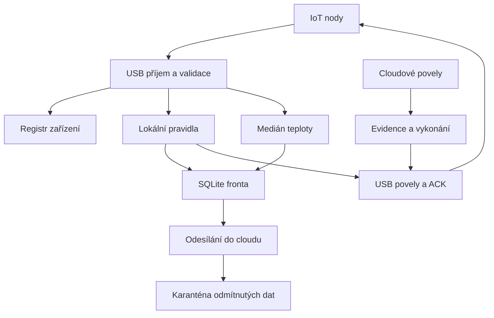

# IoT Gateway – návrh Node-RED flow

> Zdroj pro stránku **BIOT DL Application Model – Tým 1 → IoT Gateway**.
> Formát zpráv s nodem je v `iot-protocol.md`, commandy pro cloud v `command-list-gateway.md`.


## Přehled bloků flow

| Blok | Uzly / činnost | Výstup |
|---|---|---|
| Inicializace | inject při startu, SQLite, credentials adaptér | obnovená konfigurace, stav hry a fronty |
| Sériový vstup | serial in, kontrola délky, json, switch podle `t` | validované zprávy nodů |
| Registr zařízení | hello, hb, err, časovač dostupnosti | seznam přítomných zařízení a hwId → deviceId |
| Herní logika | function, uložená pravidla, SQLite transakce | změny hádanek, události a požadované stavy LED |
| Agregace teploty | SQLite vzorky, časovač uzavření okna, function medián | dokončená měření |
| Cloudový odesílač | výběr dávky, http request, vyhodnocení odpovědi | potvrzená data nebo další pokus / karanténa |
| Heartbeat a konfigurace | inject 30 s, http request | cloudový heartbeat a případná nová konfigurace |
| Příjem cloudových povelů | inject 2 s, getCommands, SQLite evidence | seřazené úlohy pro lokální vykonání |
| Sériový výstup | překlad povelu, serial out, čekání na ack | potvrzené nastavení zařízení |
| Potvrzení cloudových povelů | ackCommands, retry | potvrzení dokončených úloh v cloudu |
| Diagnostika a úklid | catch/status, dashboard, hodinový inject | stav systému, alarmy, mazání po retenci |

---

## 1. Úloha a prostředí

Gateway běží na Raspberry Pi 5 jako Node-RED služba. Přes USB komunikuje s Arduino nody,
lokálně vyhodnocuje pravidla hádanek a přes HTTPS komunikuje s cloudem. Internet není nutný
pro pokračování již připravené hry, ale živý webový přehled a nové cloudové povely během výpadku nefungují.

Návrh používá sériové uzly, `json`, `switch`, `function`, `inject`, `delay`, `http request`,
`catch`, `status`, SQLite adaptér a dashboard. Konkrétní verze balíků se uzamknou při implementaci.
Flow je rozdělené do logických subflow. Zapojení pinů a parametry senzorů patří
do návrhu IoT nodu.

---

## 2. Struktura flow



HTTP operace jsou asynchronní; nedostupný cloud nezastavuje USB příjem a lokální logiku.
Zápisy stavu hry a SQLite obsluhuje jediná serializovaná cesta, aby dva souběžné podněty
nevyřešily stejnou hádanku dvakrát. Přenos událostí a měření má oddělené plánování.

---

## 3. Start, registrace a konfigurace

**Kroky**

1. Otevře lokální SQLite databázi a obnoví fronty, uloženou konfiguraci, rozpracované úlohy a okna teplot.
   RAM je pouze cache, ne jediný zdroj neodeslaných dat.
2. Načte token z Node-RED credentials. Pokud chybí, dashboard nabídne zadání registračního kódu.
   Dokud není identita a konfigurace známá, neprovádí herní akce.
3. Registrační blok volá `gateway/register`. Token musí trvale uložit před zahájením běžné komunikace;
   kód následně odstraní z formuláře i paměti. Při ztrátě registrační odpovědi se postupuje novou
   registrací dle Command Listu, nikoliv neomezeným opakováním spotřebovaného kódu.
4. Otevře USB porty a počká na `hello`. Konfiguraci stáhne přes `gateway/getConfig` a uloží atomicky.
   Při výpadku použije platnou poslední kopii; bez ní ukáže stav „Čeká na konfiguraci“.
5. Spustí aktuální heartbeat a zpracování povelů. Před vyhodnocováním hry ověří odpovídající
   `scenarioRevision`. Nová pravidla nevymění uprostřed běžící hry bez odpovídajícího resetu.

### Uložení tokenu

Navržený credentials adaptér je malý vlastní Node-RED uzel/config node
s credential polem typu `password`. Přijme token uvnitř registračního bloku a zajistí jeho
uložení přes mechanismus credentials včetně trvalého zápisu. Běžný Function/global context
není automaticky credentials úložiště. Implementace musí ověřit obnovu tokenu po restartu
bez ručního Deploy. Pokud ji zvolený adaptér nezajistí, jde o nedokončenou registraci.
Token se neposílá do dashboardu, debug výstupů, SQLite payloadů ani exportovaného flow.
Do HTTP hlavičky se přidá až těsně před požadavkem a před diagnostikou se odstraní.

`credentialSecret` je stabilní tajná hodnota mimo Git, dostupná jen účtu služby;
credentials soubor má omezená oprávnění. V cloudu je pouze hash, na gateway musí být
obnovitelný token pro autentizaci. Editor i dashboard vyžadují přihlášení a HTTPS
nebo chráněný lokální přístup; samotné `adminAuth` automaticky nechrání dashboard.

---

## 4. USB komunikace a dostupnost

Platí společný protokol: **115 200 Bd, 8N1, JSON Lines**, jeden řádek ukončený LF,
tolerance CRLF. Příjem má limit 512 B a výstup 128 B dle protokolu.
Příliš dlouhý řádek se zahazuje až po další LF, neplatný JSON a neznámý typ se počítají v diagnostice.

| Zpráva | Zpracování gateway |
|---|---|
| `hello` | přiřadí port k NODE_ID, zkontroluje zařízení a obnoví registry; při skutečném restartu nodu obnoví požadované stavy LED |
| `ev` | přidělí čas přijetí a UUID, uloží událost; vyhodnotí press / tilt / move |
| `m` | validuje teplotu, uloží vzorek a současně vyhodnotí teplotní pravidla |
| `hb` | obnoví živost nodu, sleduje uptime a restart |
| `ack` | spáruje odpověď s čekajícím cid na konkrétním portu |
| `err` | zobrazí závadu, označí vadný senzor jako nedostupný |

Po otevření portu může DTR restartovat Arduino. Gateway čeká na `hello`, po 3 s odešle `who`.
Při odpojení opakuje otevření portu každých 5 s. Preferuje stabilní cestu `/dev/serial/by-id/`,
pokud ji převodník poskytuje; jinak administrátor nastaví port a identitu ověří podle `hello`.
Samotné pořadí ttyACM portů neurčuje identitu nodu.

Node vysílá hb každých 5 s. Po 15 s bez validní zprávy je node offline a jeho zařízení se
vynechají z cloudového heartbeat. Vadný senzor se neozdraví jen proto, že node poslal hb;
obnoví se validním měřením, událostí nebo ověřením po opravě. Node po obnově senzoru pošle nové `hello`;
zařízení, které v něm je, se tím obnoví. U tichého tlačítka či LED může obsluha vyvolat nové ohlášení po opravě. Prázdný seznam zařízení je platný.

`seq` se kontroluje modulo 65536; mezera vyvolá diagnostiku, ne žádost o opakování.
Změna uptime směrem dolů nebo znovuotevření portu zahájí novou relaci; `hello` jako odpověď
na `who` samo o sobě restart nedokazuje. Ztrátu USB události protokol neopravuje.

`hwId` má tvar `node1.btn1` a je unikátní v místnosti. Dvě současná připojení se stejným
NODE_ID/hwId jsou konflikt: dotčená zařízení se nepoužijí pro herní akce a zobrazí se alarm,
nikoliv sloučení dat. Heartbeat získá cloudová deviceId. Do té doby se události drží s hwId
ve stavu waitingMapping; jejich UUID a čas se zachovají, DTO se dokončí před prvním odesláním.

---

## 5. Lokální pravidla a stav hry

Gateway ukládá revizi konfigurace, gameId, stav hry, časy a stavy hádanek. Pravidla spouští
jen ve stavu running a se správnou revizí. Podmínky tilt/temperature vyhodnocuje nad okamžitou
hodnotou, nikoliv nad pětiminutovým mediánem. Z press tlačítka hintDeviceId vytvoří samostatný
`hintRequested`; každý nový event má vlastní UUID. Událost zařízení může být uložena i mimo hru,
ale bez dodatečného přiřazování gameId při pozdějším uploadu.

Splnění pravidla se uloží společně se změnou stavu hádanky, `puzzleSolved` a požadovanými
akcemi v jedné lokální transakci. Poté vykonavatel odešle absolutní stavy LED. Selhání LED
nezahodí už zaznamenanou událost; požadovaná akce zůstává k opakování a zobrazí se závada.
Již vyřešenou hádanku automatická pravidla znovu neřeší. Pause/stop zastaví vyhodnocování,
měření a přenos diagnostických dat pokračují.

Při vyřešení poslední hádanky nebo vypršení místního limitu se lokální vyhodnocování zastaví.
Cloudové události gameCompleted/gameExpired gateway nevyrábí (API je nepřijímá);
cloud dokončení odvodí z puzzleSolved a vypršení ze svého časovače.
Po restartu nesmí starý cloudový snímek bez rozmyslu přepsat novější lokální stav.
Gateway nejprve odešle čekající události, zpracuje potvrzené/čekající povely a načte stav znovu.
Při nesouladu gameId nebo chybějící požadované revizi přejde do „Vyžaduje synchronizaci“
a nepokračuje v automatických akcích, dokud není konflikt vyřešen. Opožděné události
ukončené hry zůstávají historií dle cloudového kontraktu.

---

## 6. SQLite fronta a obnova

Databáze je na místním disku, např. `/var/lib/escape-gateway/gateway.sqlite`, dostupná účtu služby.
Návrh: WAL, `synchronous=FULL`, parametrizované dotazy a jedna řízená zapisovací cesta.
Transakce se provádí na stejném spojení; několik nezávislých Function uzlů nesmí prokládat
BEGIN/COMMIT. WAL umožňuje souběžné čtení dashboardu, nikoliv více současných zapisovatelů.

| Tabulka | Podstatné údaje |
|---|---|
| `outbox` | lokální pořadí, kind, event UUID / měřicí klíč, neměnný payload, stav, attempts, nextAttemptAt, lastError, confirmedAt |
| `samples` | hwId/deviceId, čas přijetí, hodnota, windowStart; otevřené okno přežije restart |
| `config` | úplná konfigurace, revize, identita místnosti |
| `runtime_state` | hra, stavy hádanek, požadované LED, čítač cid |
| `command_log` | cloud commandId, payload, pořadí, stav přijetí/provedení/potvrzení, časy |
| `serial_jobs` | cílový node, cid, typ, payload, pokusy a výsledek ack |

### Stavy fronty

| Stav | Význam |
|---|---|
| `waitingMapping` | čeká na přiřazení cloudového deviceId |
| `pending` | připraveno k odeslání |
| `inFlight` | probíhá pokus o odeslání |
| `confirmed` | cloud potvrdil přijetí nebo shodnou duplicitu |
| `quarantined` | trvale odmítnutý záznam čeká na opravu příčiny |
Karanténa je stav stejné tabulky, takže přesun nepotřebuje smazat původní záznam.
Unikátní klíč lokální události je UUID, měření deviceId + windowStart (před mapováním hwId + windowStart).
Payload po prvním pokusu zůstává neměnný. Přijetí do trvalé fronty je dokončeno až po COMMIT.

Při startu se nedokončené `inFlight` vrátí do pending: cloud mohl dávku přijmout a odpověď se
ztratila. Opakuje se stejný obsah a stejné klíče. Události se odesílají v lokálním pořadí,
jedna rozpracovaná dávka událostí najednou, měření mají vlastní odesílač.
Jeden pomalý HTTP požadavek nezablokuje příjem ani SQLite zápisy.

---

## 7. Odesílání a trvale odmítnuté dávky

Běžný upload spouští vložení události nebo dokončení okna; při nahromadění dat vybírá až
100 způsobilých položek. Po úspěchu naváže další dávkou. Záznam označí confirmed až po
validní odpovědi, která obsahuje jeho ID v accepted nebo duplicate seznamu. Samotný HTTP 200
bez odpovídajícího potvrzení nestačí. `lateEvent` je přijatá událost s varováním, ne karanténa.

| Výsledek | Postup |
|---|---|
| Timeout, výpadek, 5xx | zachovat data, retry např. 2, 4, 8… nejvýše 60 s s malým náhodným rozptylem |
| 429 | respektovat Retry-After; bez něj použít rostoucí odstup |
| 401/403 | zastavit cloudové odesílání, alarm autentizace/oprávnění; nerozdělovat dávky ani nezahazovat data |
| 400/404 s rozpoznanou datovou chybou API | izolovat vadné záznamy postupem níže |
| 409 eventIdConflict/measurementConflict | izolovat konflikt, zachovat původní obsah; neměnit UUID |
| HTML 404, chybná URL nebo nerozpoznaná odpověď | chyba služby/konfigurace, pozastavit endpoint; neoznačit celou frontu za vadná data |

### Izolace trvale odmítnutého záznamu

**Kroky**

1. Cloudový kontrakt říká, že validací odmítnutá dávka 400/404/409 nezapsala nic.
   Pro známé dočasně napravitelné situace nejprve obnoví mapování/config jednou, případně počká
   na srovnání hodin. Nemění již odeslaný obsah události.
2. Pokud chyba trvá a paramMap neurčuje spolehlivě vadnou položku, rozdělí dávku na poloviny.
   Zpracuje levou a potom pravou část, opakuje dělení až na jednotlivé záznamy.
   Tím zachová pořadí odesílatelných událostí; neodesílá poloviny souběžně.
3. Jednotlivý trvale odmítnutý záznam atomicky označí `quarantined`, uloží HTTP status,
   kód API chyby, poslední odpověď bez tajných údajů, čas a počet pokusů. **Nemaže jej.**
4. Pokračuje ostatními záznamy. Karanténa se nevybírá do automatického uploadu, takže vadná položka
   nezablokuje frontu. Zpracování dělení má omezenou rychlost, aby nezaplavilo cloud.
5. Dashboard zobrazí počet, nejstarší chybu a detail/export záznamu. Po odstranění příčiny může
   obsluha vrátit konkrétní nezměněný záznam do pending. Bez opravy se automaticky nevrací.
   Pokud je nutná změna historického payloadu, řeší se jako řízená oprava s auditní stopou,
   nikoliv přidělení nového UUID za účelem obejití kontroly duplicit.

Například v dávce 100 událostí odkazuje jedna na neexistující zařízení. Rozdělením se izoluje,
99 platných událostí se potvrdí a jedna zůstane v karanténě. U trvalé chyby celého formátu se
po opakování stejné chyby na několika samostatných položkách pozastaví endpoint a vyhlásí alarm;
je zbytečné projít stejným chybovým požadavkem celou databázi. Ostatní endpointy mohou pokračovat.

Při návratu internetu pošle aktuální heartbeat, obnoví mapování a pokračuje pending daty se
stejnými UUID/okny. Obsluha cloudových povelů zůstává oddělená a dostupná, ale změny gameId
se koordinují s uloženým lokálním stavem. Historická data se nikdy nepřiřadí nové hře.

---

## 8. Downsampling a retence

### Medián teploty

Vzorek teploty každých 10 s se uloží před agregací. Okno je 300 s zarovnané podle UTC,
`windowStart = floor(timestamp / 300) * 300`, interval zahrnuje začátek, konec zahrnut není.
Na konci okna se hodnoty seřadí: při lichém počtu prostřední hodnota, při sudém průměr dvou
prostředních. `sampleCount` je skutečný počet platných vzorků.
Bez vzorků se měření nevytvoří. Chybné hodnoty a hlášení err se do mediánu nezapočítávají.

Uzavření okna a vložení jediného outbox měření tvoří transakci; až poté lze smazat jeho
surové vzorky. Po restartu se uzavřou starší otevřená okna z uložených vzorků a pokračuje
aktuální okno. Jednou odeslaný agregát se znovu nepřepočítává. Při nesynchronizovaných hodinách
se vyhlásí závada; nemění se zpětně již přiřazené časy a neodesílají se zjevně budoucí okna.

Medián tlumí krátké výkyvy, pětiminutové okno zachovává pomalý trend a snižuje počet záznamů
z 8640 na 288 za den a teploměr. Pravidla dostávají okamžité vzorky, takže nečekají pět minut.

### Retence

| Data | Retence |
|---|---|
| pending, waitingMapping, inFlight | bez časového omezení |
| quarantined | bez časového omezení; nejde o úspěšně odeslaná data |
| confirmed události/měření | 24 h od potvrzení cloudem, poté hodinový úklid |
| provedené, ale cloudem nepotvrzené povely | bez časového omezení |
| potvrzené commandId | nejméně 7 dní od potvrzení cloudem |
| konfigurace a stav hry | do bezpečného nahrazení novým stavem |

Disk je konečný: dashboard sleduje velikost DB a volné místo. 
Při zaplnění vyhlásí kritickou závadu, zastaví nové herní akce
vyžadující trvalý zápis a obsluha řeší kapacitu. Sériový protokol nemá zpětný tlak ani retry
senzorových zpráv, takže při poruše/zaplnění disku riskujeme ztrátu dat.

---

## 9. Heartbeat a povely

### Heartbeat

Cloudový heartbeat vzniká každých 30 s z čerstvého registru zařízení, i když tlačítka mlčí.
Nese skutečně lokálně uloženou revizi; při configChanged se stáhne konfigurace.
Chyba jednoho známého zařízení se řeší v registru, aby neplatný seznam neblokoval další hlášení.
Heartbeat není součástí offline outbox. Cloud odvozuje offline stav po 60 s bez kontaktu.

### Vyzvednutí a provedení povelů

`gateway/getCommands` se volá každé 2 s bez překryvu, při síťové chybě s odstupem.
Nové commandId a celý payload se nejdřív uloží do command_log. Vykonání je sériové
v pořadí dodaném cloudem; novější povel nepředběhne neúspěšný.

| Cloudový povel | Lokální provedení |
|---|---|
| resetRoom | ověřit revizi, zajistit konfiguraci, reset na všech dostupných požadovaných nodech, nová hra a nevyřešené hádanky |
| startGame | aktivovat odpovídající gameId, čas startu a limit |
| pauseGame / resumeGame | změnit místní stav a evidenci pauzy |
| stopGame | zastavit pravidla a uložit koncový stav |
| solvePuzzle | označit hádanku vyřešenou; pouze při runActions provést její LED akce |
| unsolvePuzzle | vrátit hádanku do nevyřešeného stavu |

Sériový vykonavatel převádí cloudová ObjectId na krátké cid (nejvýše 8 znaků).
Ukládá mapování cloud commandId → dílčí sériové úlohy. Na jednom nodu má jeden povel v letu;
počítadlo cid se uchovává na disku a nesmí kolidovat s dosud čekající úlohou.
Před odesláním kontroluje délku celé zprávy včetně oddělovače podle upřesněného protokolu.

ACK se čeká 500 ms; po počátečním pokusu následují nejvýše 3 opakování se stejným cid.
`ok:false` je selhání, ne úspěšné vykonání. Po vyčerpání pokusů označí dotčené zařízení/nod
nedostupným a zobrazí závadu; další kolo provede až po obnově spojení nebo zásahu obsluhy,
ne v nekonečné rychlé smyčce. `who` vyžaduje i přijetí hello pro obnovu seznamu zařízení.

### Potvrzení zpracování

Teprve po potvrzení všech nutných akcí a trvalém uložení výsledku přejde cloudový povel
do executed a volá se `gateway/ackCommands`. Při ztracené odpovědi opakuje pouze cloudový ACK.
Znovu doručené executed/confirmed commandId se nevykoná. Chybný řídicí povel nelze jen
odložit do karantény a přeskočit jako telemetrii: zachová se pořadí a vyžádá zásah.

Po pádu mezi fyzickou akcí a zápisem výsledku může být sériový povel opakován.
LED používá absolutní stav. U resetu se nepokračuje ve hře, dokud není
reset dokončen. Bez potvrzené idempotence firmware nelze slibovat přesně jedno provedení.

---

## 10. Lokální dashboard

Dashboard slouží k provozu a diagnostice gateway, nenahrazuje webový editor hry.
Zobrazuje připojení cloudu, gatewayId a místnost, revizi konfigurace, stav hry, seznam nodů
s posledním kontaktem, dostupnost zařízení a poslední teplotu. Dále počty pending/confirmed/
quarantined, stáří nejstarších dat, volné místo a poslední chyby USB/HTTP/SQLite.

Obsluha může zadat registrační kód, vyžádat obnovu konfigurace, zobrazit/exportovat karanténu
bez tokenů a ručně obnovit odeslání vybraného záznamu po opravě příčiny.
Start, pause a reset hry zajišťují cloudové commandy.

---

## 10a. Rozšíření: klávesnice, enkodér, LCD (implementováno 21. 11. 2026)

Gateway přijímá node s firmwarem 1.1.0 a `ENABLE_EXTENSIONS = 1` (zprávy v `iot-protocol.md` kap. 9).
Cloud typy `keypad`, `encoder`, `display` zatím nezná, proto gateway rozlišuje dva seznamy typů (`gw.js`):

| Seznam | Obsah | Použití |
|---|---|---|
| `DEVICE_TYPES` | MVP + `keypad`, `encoder`, `display` | kontrola `hello` od nodu |
| `CLOUD_DEVICE_TYPES` | jen MVP | `gateway/heartbeat` a fronta událostí; ostatní zařízení jsou **jen lokální** |

Události lokálních zařízení (`key`, `code`, `turn`) se **neukládají do fronty**: cloud by je odmítl a bez mapování
by čekaly neomezeně (retence neodeslaných dat). Gateway si pamatuje poslední hodnotu pro dashboard a vyhodnotí
nad nimi pravidla. Až cloud nové typy doplní, stačí je přidat do `CLOUD_DEVICE_TYPES`.

**Pravidla.** Gateway umí podmínku `eq` (přesná shoda: kód `"1234"`, poloha `7`) a akci
`showText` `{ type, deviceId, line1, line2 }`, která pošle povel `lcd`. Text se převede na ASCII bez diakritiky
(nejvýš 16 znaků na řádek). Požadovaný text LCD se ukládá do `kv` (`displays`) a po restartu nodu se obnoví
stejně jako LED; `resetRoom` displej smaže.

**Dashboard.** Řádek *Rozšíření* ukazuje poslední kód, polohu enkodéru a text LCD. Skupina *Displej nodu (LCD)*
má formulář pro ruční text na displeji (test a ukázka, než pravidla `showText` dodá cloud; ruční text se drží
jen v paměti).

---

## 11. Autostart přes systemd

Použije se `nodered.service` z instalace Node-RED pro Raspberry Pi OS, nikoliv druhá paralelní
instance. Služba běží pod vyhrazeným neprivilegovaným účtem, který má přístup k USB sériovým
portům (skupina dialout), svému userDir a adresáři SQLite. Běh jako root není nutný.

Po instalaci a nastavení služby:

```bash
sudo systemctl enable --now nodered.service
systemctl status nodered.service
journalctl -u nodered.service -n 50 --no-pager
```

Navržený drop-in přes `sudo systemctl edit nodered.service`:

```ini
[Service]
Restart=on-failure
RestartSec=5
UMask=0077
```

Po změně nastavení služby se provede daemon-reload a restart. Účet služby a cesty se
ověří proti skutečné instalaci (`systemctl cat nodered.service`). Start nečeká na dostupnost
cloudu: nejprve obnoví lokální stav a spojení navazuje samostatně. Při běžném ukončení
přestane vybírat nové dávky a dokončí aktuální lokální transakci; při násilném výpadku se
spoléhá na obnovu SQLite. Logy neobsahují Authorization ani registrační odpověď.

---

## 12. Ověření návrhu při implementaci

| Zkouška | Očekávaný výsledek |
|---|---|
| Restart RPi bez internetu | služba se spustí, obnoví token, konfiguraci i pending data |
| Tlačítko se nemačká 10 minut | díky hb nodu zůstává dostupné |
| Odpojení USB | po 15 s node offline, obnova portu po 5 s; návrat přes hello |
| Dva nody se stejným NODE_ID | konflikt na dashboardu, žádné sloučení zařízení |
| 30 teplotních vzorků v okně | jediný medián, sampleCount 30; pravidla reagují průběžně |
| Restart uprostřed okna | obnoví vzorky, nevytvoří dvě měření stejného okna |
| Výpadek internetu a 250 událostí | po obnově dávky nejvýše 100, zachované UUID a pořadí |
| Cloud uloží dávku, odpověď se ztratí | retry vrátí duplicity, žádné dvojí započtení nápovědy |
| Jedna neplatná položka v dávce | izolace do karantény, ostatní a další dávky pokračují |
| 401 nebo HTML 404 | závada připojení/konfigurace, žádné hromadné zahazování do karantény |
| Ztracený sériový ACK / cloudový ACK | příslušný retry, cloudový retry neopakuje provedenou akci |
| Úklid po 24 h | smaže jen confirmed data; pending a karanténa zůstanou |
| Plný disk | viditelná kritická chyba, žádný falešný příslib uložení |

