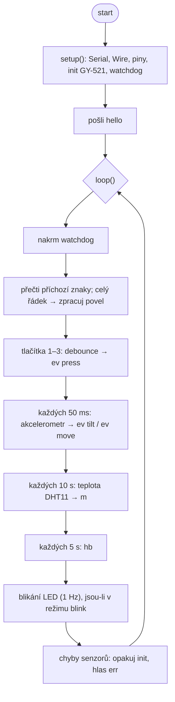

# Firmware IoT Node

> Zdroj pro stránku **BIOT DL Application Model – Tým 1 → IoT Node** (část firmware).
> Zapojení a piny jsou v `iot-hardware.md`, formát zpráv v `iot-protocol.md`.

## 1. Přehled

Firmware běží na **Arduino Mega 2560** a je napsaný v Arduino C++ (Arduino IDE nebo PlatformIO).
Dělá jen čtyři věci a o hře nic neví:

1. čte senzory (3 tlačítka, akcelerometr, teploměr DHT11),
2. hlásí události, vzorky teploty a svůj stav gateway (`iot-protocol.md`),
3. vykonává povely z gateway (2 LED, reset),
4. hlídá chyby senzorů a sám se zotaví ze zaseknutí (watchdog).

Klávesnici, enkodér a LCD (2. fáze, `iot-hardware.md` kap. 6) firmware obsluhuje jen s přepínačem
`ENABLE_EXTENSIONS = 1` (kap. 11); ve výchozím nastavení je nepoužívá a jejich piny nechává jako vstupy.

| Knihovna | Účel |
|---|---|
| `Wire` (součást Arduina) | sběrnice I2C pro GY-521 |
| **ArduinoJson** 7.x | sestavení a čtení zpráv JSON |
| **DHT sensor library** (Adafruit) 1.4.x + Adafruit Unified Sensor | čtení DHT11 |
| `avr/wdt.h` (součást toolchainu) | watchdog |

Akcelerometr se čte **přímo přes registry** MPU-6050, bez další knihovny: potřebujeme jen zrychlení ve třech osách.

## 2. Konfigurace (`config.h`)

| Konstanta | Hodnota | Význam |
|---|---|---|
| `NODE_ID` | `"node1"` | identifikace nodu, prefix všech `hwId` |
| `FW_VERSION` | `"1.1.0"` | verze firmwaru v `hello` |
| `ENABLE_EXTENSIONS` | `0` | `1` = obsluha klávesnice, enkodéru a LCD (kap. 11) |
| `PIN_BUTTONS` | `{2, 3, 4}` | tlačítka 1–3 |
| `PIN_LEDS` | `{22, 23}` | LED zelená, červená |
| `PIN_DHT` | `5` | DHT11 |
| `MPU_ADDR` | `0x68` | I2C adresa GY-521 |
| `SERIAL_BAUD` | `115200` | rychlost linky |
| `DEBOUNCE_MS` | `30` | ošetření zákmitů tlačítka |
| `ACCEL_PERIOD_MS` | `50` | čtení akcelerometru (20 Hz) |
| `TILT_DEADBAND_DEG` | `5` | minimální změna náklonu pro odeslání |
| `TILT_MIN_INTERVAL_MS` | `200` | nejvýš 5 zpráv `tilt` za sekundu |
| `MOVE_THRESHOLD_G` | `0.3` | odchylka od 1 g, která znamená pohyb |
| `MOVE_COOLDOWN_MS` | `1000` | pauza po hlášení pohybu |
| `TEMP_PERIOD_MS` | `10000` | vzorek teploty |
| `TEMP_FAIL_LIMIT` | `3` | počet neúspěšných čtení DHT11 po sobě, po kterém se teploměr vyřadí z `hello` |
| `TEMP_MIN_C`, `TEMP_MAX_C` | `0`, `50` | rozsah DHT11, mimo něj chyba senzoru |
| `HB_PERIOD_MS` | `5000` | heartbeat nodu |
| `SENSOR_RETRY_MS` | `5000` | opakování inicializace a hlášení chyby senzoru |
| `RX_BUFFER` | `128` | max. délka povelu od gateway |

`hwId` se skládají z `NODE_ID`: `node1.btn1`–`node1.btn3`, `node1.acc1`, `node1.temp1`, `node1.led1` (zelená), `node1.led2` (červená).

## 3. Struktura programu

Hlavní smyčka **nikde nečeká** (`delay()` se v ní nepoužívá). Smyčka `loop()` běží stále dokola a každá úloha
si podle `millis()` hlídá, jestli už nastal její čas. Tlačítko tak zareaguje do pár milisekund,
i když se zrovna měří teplota.



| Úloha | Perioda | Výstup |
|---|---|---|
| příjem povelů | každý průchod smyčkou | `ack`, `err` |
| tlačítka | každý průchod smyčkou | `ev press` |
| akcelerometr | 50 ms | `ev tilt`, `ev move` |
| teplota | 10 s | `m` |
| heartbeat | 5 s | `hb` |
| blikání LED | 500 ms (přepnutí) | – |
| chyby senzorů | 5 s | `err`, `hello` |

Kostra hlavní smyčky:

```cpp
void loop() {
  wdt_reset();                      // watchdog: smyčka běží
  unsigned long now = millis();

  readSerialCommands();             // řádek → handleCommand()
  updateButtons(now);
  if (now - lastAccelMs >= ACCEL_PERIOD_MS) { lastAccelMs = now; updateAccelerometer(now); }
  if (now - lastTempMs  >= TEMP_PERIOD_MS)  { lastTempMs  = now; sampleTemperature(); }
  if (now - lastHbMs    >= HB_PERIOD_MS)    { lastHbMs    = now; sendHeartbeat(now); }
  updateLedBlink(now);
  checkSensorHealth(now);
}
```

Odčítání `now - last…` funguje správně i po přetečení `millis()` (asi po 49 dnech provozu).

## 4. Start

1. `Serial.begin(115200)`, `Wire.begin()`, `dht.begin()`, tlačítka `INPUT_PULLUP`, LED `OUTPUT` a zhasnuté.
2. Inicializace GY-521: zápis `0x00` do registru `PWR_MGMT_1` (`0x6B`) čip probudí,
   zápis `0x00` do `ACCEL_CONFIG` (`0x1C`) nastaví rozsah ±2 g. Kontrola: registr `WHO_AM_I` (`0x75`) musí odpovědět.
   Originální MPU-6050 vrací `0x68`, klony na levných modulech GY-521 (MPU-6500 apod.) jinou hodnotu se stejnými
   registry zrychlení; za chybu se proto bere jen žádná odpověď (`0x00`, `0xFF`). Sběrnice I2C má časový limit 3 ms
   (`Wire.setWireTimeout`), aby odpojený modul nezasekl program.
3. Úvodní měření náklonu, aby první `tilt` odpovídal skutečné poloze.
4. Zapnutí watchdogu na 2 s (`wdt_enable(WDTO_2S)`).
5. Po 1 s (DHT11 se po zapnutí napájení ustaluje; jediné čekání ve firmwaru, ještě před zapnutím watchdogu)
   úvodní čtení DHT11; když se nepovede, `node1.temp1` se do `hello` nezařadí.
6. Odeslání `hello` se seznamem **funkčních** zařízení. Když GY-521 neodpovídá, `node1.acc1` v seznamu chybí
   a node pošle `err` se `sensorNotResponding`.

Gateway při otevření portu Arduino restartuje (signál DTR), takže `hello` přijde vždy po připojení.

## 5. Senzory

### Tlačítka (`node1.btn1`–`node1.btn3`)

Stisk stáhne pin (D2, D3, D4) na LOW. Každé tlačítko se ošetřuje samostatně, takže lze zmáčknout i dvě najednou.
Firmware si u každého pamatuje poslední přečtenou hodnotu a čas její změny.
Novou hodnotu uzná až tehdy, když je stabilní **30 ms**: kontakty tlačítka při stisku několik milisekund „zakmitají“
a bez ošetření by jeden stisk vypadal jako několik. Při přechodu do stabilního LOW pošle:

```json
{"t":"ev","id":"node1.btn1","e":"press","seq":42}
```

Uvolnění tlačítka se nehlásí. Pořadí stisků (kombinace) vyhodnocuje gateway.

### Akcelerometr (`node1.acc1`)

Každých 50 ms přečte 6 bajtů od registru `ACCEL_XOUT_H` (`0x3B`): osy X, Y, Z jako 16bitová čísla se znaménkem.
Při rozsahu ±2 g odpovídá 1 g hodnotě **16 384**.

```
ax, ay, az = surová hodnota / 16384        // v g
|a|        = √(ax² + ay² + az²)
```

**Pohyb (`move`).** Předmět v klidu má velikost zrychlení 1 g (gravitace). Když se `| |a| − 1 g |` zvýší nad **0,3 g**,
předmětem někdo pohnul nebo s ním třese. Node pošle `ev move` a další pohyb hlásí nejdřív za 1 s.

**Náklon (`tilt`).** Aby šum nerozkmitával hodnotu, každá osa se nejdřív vyhladí plovoucím průměrem
(`f = 0,8 · f + 0,2 · nová hodnota`). Náklon je úhel mezi osou Z a svislicí:

```
tilt = acos( fz / |f| ) · 180 / π          // 0° výchozí poloha, 180° vzhůru nohama
```

Node pošle `ev tilt` (celé stupně), když se náklon od poslední **odeslané** hodnoty změnil aspoň o **5°**
a od posledního `tilt` uplynulo aspoň 200 ms. Pásmo 5° funguje jako hystereze: hodnota, která kolísá kolem
jedné polohy, nevyvolá příval zpráv. Prahy z pravidel hádanek (např. „> 45°“) vyhodnocuje gateway.

Při prudkém pohybu je náklon dočasně nepřesný, protože akcelerometr měří i zrychlení pohybu, nejen gravitaci.
Vyhlazení to tlumí; po uklidnění předmětu se hodnota ustálí. Gyroskop MPU-6050 v MVP nepoužíváme.

### Teplota (`node1.temp1`)

Každých 10 s:

1. Přečte teplotu z DHT11 (`dht.readTemperature()`). Downsampling teploty (medián za 5 min) dělá gateway.
2. Když čtení selže (knihovna vrátí `NaN`, typicky odpojený datový vodič), pošle `err` se `sensorNotResponding`.
   Po **3 neúspěšných čteních po sobě** teploměr vyřadí z `hello` a pošle nové `hello`; po prvním úspěšném čtení ho vrátí.
3. Zkontroluje rozsah DHT11 0–50 °C; mimo něj pošle `err` se `sensorOutOfRange` místo vzorku.
4. Pošle vzorek v celých °C (DHT11 jemnější rozlišení nemá):

```json
{"t":"m","id":"node1.temp1","v":23,"seq":45}
```

**Blokující čtení.** Jedno čtení DHT11 trvá asi 25 ms a knihovna při něm na několik milisekund vypne přerušení.
Tlačítko se tak může ohlásit o 25 ms později, což hráč nepozná. Znaky povelu, které přijdou ze sériové linky právě
v okamžiku vypnutých přerušení, se mohou ztratit. Povel se pak nedá přečíst nebo nedojde celý, node nepošle `ack`
a gateway povel po 500 ms zopakuje (`iot-protocol.md` kap. 4). Při čtení jednou za 10 s jde o výjimečnou situaci.

## 6. Příjem povelů

Znaky ze sériové linky se ukládají do bufferu o velikosti 128 B, dokud nepřijde `\n`.
Hardwarový vstupní buffer Arduina má jen 64 B, ale smyčka ho čte průběžně, takže nepřeteče.
Když řádek buffer přeteče, node zahazuje znaky do nejbližšího `\n` a pošle `err` s `badMessage`.
Hotový řádek rozparsuje ArduinoJson a podle `t` provede povel:

| `t` | Akce | Odpověď |
|---|---|---|
| `led` | ověří `id` (`node1.led1` nebo `node1.led2`) a nastaví stav `on`, `off` nebo `blink` | `ack ok:true`; neznámé `id` → `ack ok:false`, `err:"unknownDevice"` |
| `reset` | zhasne obě LED a vynuluje vnitřní stav: referenci náklonu (další `tilt` se pošle hned) a stav tlačítek | `ack ok:true` |
| `who` | pošle `hello` | `ack ok:true` a `hello` |
| jiné | nic | `ack ok:false`, `err:"unknownCommand"` |

Neplatný JSON nebo chybějící `cid` → `err` s `badMessage` (bez `ack`, protože není na co odpovědět).
Povely nastavují absolutní stav, takže opakovaný povel nic nepokazí a node nemusí hlídat duplicity.

## 7. Odesílání zpráv

Všechny zprávy jdou přes jednu funkci `send()`: doplní `seq` (kromě `hello`), zprávu serializuje
do jednoho řádku, ukončí `\n` a zvýší počítadlo `seq` (0–65 535, pak znovu od 0).

Heartbeat každých 5 s:

```json
{"t":"hb","node":"node1","up":3600,"seq":46}
```

## 8. Chyby a zotavení

| Situace | Chování nodu |
|---|---|
| GY-521 neodpovídá při startu nebo za běhu | `node1.acc1` vyřadí z `hello`, každých 5 s zkusí inicializaci znovu a pošle `err sensorNotResponding`; po obnovení pošle nové `hello` |
| DHT11 nevrací hodnotu | `err sensorNotResponding` při každém neúspěšném čtení; po 3 neúspěších po sobě vyřadí `node1.temp1` z `hello`, po obnovení pošle nové `hello` |
| teplota mimo rozsah | místo vzorku `err sensorOutOfRange` (každých 10 s, dokud trvá) |
| neplatný povel | `err badMessage` |
| zaseknutí programu | watchdog po 2 s Arduino restartuje; po startu node pošle `hello` a gateway mu znovu nastaví LED podle stavu hry |

Gateway pozná změnu dostupnosti zařízení z nového `hello` a v `gateway/heartbeat` hlásí jen funkční zařízení.

⚠️ Starší bootloadery Arduina Mega 2560 se po restartu watchdogem zacyklí. Na skutečném kusu je potřeba ověřit,
že restart watchdogem funguje; jinak bootloader aktualizovat, nebo watchdog vypnout.

## 9. Paměť

Arduino Mega má **8 KB RAM** a 248 KB paměti programu. Přeložený firmware (`iot-node/escape-node`) zabírá
asi 24 KB programu a **940 B** globálních proměnných (buffer povelů 128 B, stav senzorů, knihovny).
Dokument ArduinoJson pro jednu zprávu (nejdelší `hello` asi 310 B) se vytváří dočasně, takže zbývá přes 7 KB rezervy.

## 10. Test bez gateway

Firmware jde vyzkoušet přímo v sériovém monitoru Arduino IDE (115 200 Bd, konec řádku „Newline“):

1. Po otevření monitoru přijde `hello` a každých 5 s `hb`.
2. Stisk tlačítek 1–3 → `ev press` s `node1.btn1`–`btn3`; naklonění modulu → `ev tilt`; zatřesení → `ev move`; každých 10 s → `m`.
3. Odeslání `{"t":"led","cid":"1","id":"node1.led1","s":"on"}` rozsvítí zelenou LED a vrátí `ack`;
   `{"t":"led","cid":"2","id":"node1.led2","s":"blink"}` rozbliká červenou.
4. Odeslání `{"t":"who","cid":"3"}` vrátí `ack` a `hello`.

Serial Monitor musí mít nastavenou **stejnou rychlost jako firmware (115 200 Bd)**; jinak ukazuje nesmyslné znaky.

## 11. Rozšíření: klávesnice, enkodér, LCD (`ENABLE_EXTENSIONS`)

S `ENABLE_EXTENSIONS = 1` firmware 1.1.0 obsluhuje zařízení 2. fáze; zprávy popisuje `iot-protocol.md` kap. 9.
Kód rozšíření je v `#if ENABLE_EXTENSIONS`, takže s `0` je přeložený program stejný jako v MVP
(23,9 KB programu, 944 B RAM); s `1` má 26,6 KB a 1 118 B RAM.

| Část | Jak funguje |
|---|---|
| Klávesnice 4x4 | maticové skenování à 5 ms: jeden řádek se stáhne na LOW, sloupce s pull-upem ukážou stisk; ostatní řádky jsou vstupy, aby dvě stisknuté klávesy nezkratovaly výstupy. Zákmity 30 ms. Kód se skládá v nodu (`*` maže, `#` odesílá, nejvýš 8 znaků) |
| Enkodér KY-040 | kvadraturní dekodér s tabulkou přechodů čtený v **každém průchodu** `loop()` (D6–D8 nemají přerušení); neplatný přechod (zákmit) se ignoruje, 4 přechody = 1 zarážka. Poloha 0–19 dokola, směr nastavuje `ENC_REVERSE`. Zprávy nejvýš à 100 ms |
| LCD 1602 | knihovna `LiquidCrystal` (součást Arduina), 4bitový režim. Řádek se přepisuje doplněný mezerami místo `lcd.clear()` (2 ms). Znaky mimo ASCII → `?` |
| DHT11 a enkodér | čtení DHT11 blokuje ~25 ms a kroky enkodéru by se ztrácely. Vzorek teploty se proto **odloží, dokud se enkodér 1 s nepohne** (`ENC_QUIET_MS`); na prototypu se vzorek posunul o 0,7 s |

| Konstanta | Hodnota | Význam |
|---|---|---|
| `KEYPAD_PERIOD_MS` | `5` | perioda skenování klávesnice |
| `CODE_MAX_LEN` | `8` | nejdelší kód |
| `ENC_POSITIONS` | `20` | poloh enkodéru na otáčku |
| `ENC_REVERSE` | `true` | otočení směru (na prototypu doprava bez otočení ubývalo) |
| `ENC_REPORT_MS` | `100` | nejkratší interval zpráv `turn` |
| `ENC_QUIET_MS` | `1000` | odklad čtení DHT11 po otočení enkodéru |

Ověřeno na prototypu 21. 11. 2026: kódy `1234`, `78` (po `*`), `ABCD`; enkodér oběma směry přes 0; stisk osy;
povel `lcd`; MVP zařízení a `seq` bez mezer.
