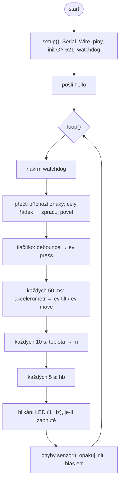

# Firmware IoT Node

> Zdroj pro stránku **BIOT DL Application Model – Tým 1 → IoT Node** (část firmware).
> Zapojení a piny jsou v `iot-hardware.md`, formát zpráv v `iot-protocol.md`.

## 1. Přehled

Firmware běží na **Arduino Mega 2560** a je napsaný v Arduino C++ (Arduino IDE nebo PlatformIO).
Dělá jen čtyři věci a o hře nic neví:

1. čte senzory (tlačítko, akcelerometr, termistor),
2. hlásí události, vzorky teploty a svůj stav gateway (`iot-protocol.md`),
3. vykonává povely z gateway (LED, reset),
4. hlídá chyby senzorů a sám se zotaví ze zaseknutí (watchdog).

| Knihovna | Účel |
|---|---|
| `Wire` (součást Arduina) | sběrnice I2C pro GY-521 |
| **ArduinoJson** 7.x | sestavení a čtení zpráv JSON |
| `avr/wdt.h` (součást toolchainu) | watchdog |

Akcelerometr se čte **přímo přes registry** MPU-6050, bez další knihovny: potřebujeme jen zrychlení ve třech osách.

## 2. Konfigurace (`config.h`)

| Konstanta | Hodnota | Význam |
|---|---|---|
| `NODE_ID` | `"node1"` | identifikace nodu, prefix všech `hwId` |
| `FW_VERSION` | `"1.0.0"` | verze firmwaru v `hello` |
| `PIN_BUTTON` | `2` | tlačítko |
| `PIN_LED` | `8` | LED |
| `PIN_THERMISTOR` | `A0` | termistor |
| `MPU_ADDR` | `0x68` | I2C adresa GY-521 |
| `SERIAL_BAUD` | `115200` | rychlost linky |
| `DEBOUNCE_MS` | `30` | ošetření zákmitů tlačítka |
| `ACCEL_PERIOD_MS` | `50` | čtení akcelerometru (20 Hz) |
| `TILT_DEADBAND_DEG` | `5` | minimální změna náklonu pro odeslání |
| `TILT_MIN_INTERVAL_MS` | `200` | nejvýš 5 zpráv `tilt` za sekundu |
| `MOVE_THRESHOLD_G` | `0.3` | odchylka od 1 g, která znamená pohyb |
| `MOVE_COOLDOWN_MS` | `1000` | pauza po hlášení pohybu |
| `TEMP_PERIOD_MS` | `10000` | vzorek teploty |
| `TEMP_READS` | `10` | počet čtení převodníku na jeden vzorek |
| `NTC_R0`, `NTC_B`, `R_FIXED` | `10000`, `3950`, `10000` | parametry termistoru a děliče ⚠️ ověřit (`iot-hardware.md` kap. 7) |
| `TEMP_MIN_C`, `TEMP_MAX_C` | `-20`, `80` | platný rozsah, mimo něj chyba senzoru |
| `HB_PERIOD_MS` | `5000` | heartbeat nodu |
| `SENSOR_RETRY_MS` | `5000` | opakování inicializace a hlášení chyby senzoru |
| `RX_BUFFER` | `64` | max. délka povelu od gateway |

`hwId` se skládají z `NODE_ID`: `node1.btn1`, `node1.acc1`, `node1.temp1`, `node1.led1`.

## 3. Struktura programu

Program **nikde nečeká** (`delay()` se nepoužívá). Hlavní smyčka `loop()` běží stále dokola a každá úloha
si podle `millis()` hlídá, jestli už nastal její čas. Tlačítko tak zareaguje do pár milisekund,
i když se zrovna měří teplota.



| Úloha | Perioda | Výstup |
|---|---|---|
| příjem povelů | každý průchod smyčkou | `ack`, `err` |
| tlačítko | každý průchod smyčkou | `ev press` |
| akcelerometr | 50 ms | `ev tilt`, `ev move` |
| teplota | 10 s | `m` |
| heartbeat | 5 s | `hb` |
| blikání LED | 500 ms (přepnutí) | – |
| chyby senzorů | 5 s | `err`, `hello` |

Kostra hlavní smyčky:

```cpp
void loop() {
  wdt_reset();                      // watchdog: smyčka běží
  unsigned long now = millis();

  readSerialCommands();             // řádek → handleCommand()
  updateButton(now);
  if (now - lastAccelMs >= ACCEL_PERIOD_MS) { lastAccelMs = now; updateAccelerometer(now); }
  if (now - lastTempMs  >= TEMP_PERIOD_MS)  { lastTempMs  = now; sampleTemperature(); }
  if (now - lastHbMs    >= HB_PERIOD_MS)    { lastHbMs    = now; sendHeartbeat(now); }
  updateLedBlink(now);
  checkSensorHealth(now);
}
```

Odčítání `now - last…` funguje správně i po přetečení `millis()` (asi po 49 dnech provozu).

## 4. Start

1. `Serial.begin(115200)`, `Wire.begin()`, `pinMode(PIN_BUTTON, INPUT_PULLUP)`, `pinMode(PIN_LED, OUTPUT)`, LED zhasnutá.
2. Inicializace GY-521: zápis `0x00` do registru `PWR_MGMT_1` (`0x6B`) čip probudí,
   zápis `0x00` do `ACCEL_CONFIG` (`0x1C`) nastaví rozsah ±2 g. Kontrola: registr `WHO_AM_I` (`0x75`) vrací `0x68`.
3. Úvodní měření náklonu, aby první `tilt` odpovídal skutečné poloze.
4. Zapnutí watchdogu na 2 s (`wdt_enable(WDTO_2S)`).
5. Odeslání `hello` se seznamem **funkčních** zařízení. Když GY-521 neodpovídá, `node1.acc1` v seznamu chybí
   a node pošle `err` se `sensorNotResponding`.

Gateway při otevření portu Arduino restartuje (signál DTR), takže `hello` přijde vždy po připojení.

## 5. Senzory

### Tlačítko (`node1.btn1`)

Stisk stáhne pin D2 na LOW. Firmware si pamatuje poslední přečtenou hodnotu a čas její změny.
Novou hodnotu uzná až tehdy, když je stabilní **30 ms**: kontakty tlačítka při stisku několik milisekund „zakmitají“
a bez ošetření by jeden stisk vypadal jako několik. Při přechodu do stabilního LOW pošle:

```json
{"t":"ev","id":"node1.btn1","e":"press","seq":42}
```

Uvolnění tlačítka se nehlásí.

### Akcelerometr (`node1.acc1`)

Každých 50 ms přečte 6 bajtů od registru `ACCEL_XOUT_H` (`0x3B`): osy X, Y, Z jako 16bitová čísla se znaménkem.
Při rozsahu ±2 g odpovídá 1 g hodnotě **16 384**.

```
ax, ay, az = surová hodnota / 16384        // v g
|a|        = √(ax² + ay² + az²)
```

**Pohyb (`move`).** Předmět v klidu má velikost zrychlení 1 g (gravitace). Když se `| |a| − 1 g |` zvýší nad **0,3 g**,
předmětem někdo pohnul nebo s ním třese. Node pošle `ev move` a další pohyb hlásí nejdřív za 1 s.

**Náklon (`tilt`).** Aby šum nerozkmitával hodnotu, každá osa se nejdřív vyhladí plovoucím průměrem
(`f = 0,8 · f + 0,2 · nová hodnota`). Náklon je úhel mezi osou Z a svislicí:

```
tilt = acos( fz / |f| ) · 180 / π          // 0° výchozí poloha, 180° vzhůru nohama
```

Node pošle `ev tilt` (celé stupně), když se náklon od poslední **odeslané** hodnoty změnil aspoň o **5°**
a od posledního `tilt` uplynulo aspoň 200 ms. Pásmo 5° funguje jako hystereze: hodnota, která kolísá kolem
jedné polohy, nevyvolá příval zpráv. Prahy z pravidel hádanek (např. „> 45°“) vyhodnocuje gateway.

Při prudkém pohybu je náklon dočasně nepřesný, protože akcelerometr měří i zrychlení pohybu, nejen gravitaci.
Vyhlazení to tlumí; po uklidnění předmětu se hodnota ustálí. Gyroskop MPU-6050 v MVP nepoužíváme.

### Teplota (`node1.temp1`)

Každých 10 s:

1. Přečte A0 desetkrát po sobě a hodnoty zprůměruje (potlačení šumu převodníku). Tento průměr se týká jen
   jednoho vzorku; downsampling teploty (medián za 5 min) dělá gateway.
2. Spočítá odpor termistoru a teplotu (rovnice v `iot-hardware.md`).
3. Zkontroluje rozsah −20 až 80 °C. Rozpojený termistor dá hodnotu převodníku u 1023, zkratovaný u 0;
   obojí skončí mimo rozsah a node pošle `err` se `sensorOutOfRange` místo vzorku.
4. Pošle vzorek zaokrouhlený na 0,1 °C:

```json
{"t":"m","id":"node1.temp1","v":23.4,"seq":45}
```

## 6. Příjem povelů

Znaky ze sériové linky se ukládají do bufferu o velikosti 64 B, dokud nepřijde `\n`.
Když řádek buffer přeteče, node zahazuje znaky do nejbližšího `\n` a pošle `err` s `badMessage`.
Hotový řádek rozparsuje ArduinoJson a podle `t` provede povel:

| `t` | Akce | Odpověď |
|---|---|---|
| `led` | ověří `id` (`node1.led1`) a nastaví stav `on`, `off` nebo `blink` | `ack ok:true`; neznámé `id` → `ack ok:false`, `err:"unknownDevice"` |
| `reset` | zhasne LED a vynuluje vnitřní stav: referenci náklonu (další `tilt` se pošle hned) a stav tlačítka | `ack ok:true` |
| `who` | pošle `hello` | `ack ok:true` a `hello` |
| jiné | nic | `ack ok:false`, `err:"unknownCommand"` |

Neplatný JSON nebo chybějící `cid` → `err` s `badMessage` (bez `ack`, protože není na co odpovědět).
Povely nastavují absolutní stav, takže opakovaný povel nic nepokazí a node nemusí hlídat duplicity.

## 7. Odesílání zpráv

Všechny zprávy jdou přes jednu funkci `send()`: doplní `seq` (kromě `hello`), zprávu serializuje
do jednoho řádku, ukončí `\n` a zvýší počítadlo `seq` (0–65 535, pak znovu od 0).

Heartbeat každých 5 s:

```json
{"t":"hb","node":"node1","up":3600,"seq":46}
```

## 8. Chyby a zotavení

| Situace | Chování nodu |
|---|---|
| GY-521 neodpovídá při startu nebo za běhu | `node1.acc1` vyřadí z `hello`, každých 5 s zkusí inicializaci znovu a pošle `err sensorNotResponding`; po obnovení pošle nové `hello` |
| teplota mimo rozsah | místo vzorku `err sensorOutOfRange` (každých 10 s, dokud trvá) |
| neplatný povel | `err badMessage` |
| zaseknutí programu | watchdog po 2 s Arduino restartuje; po startu node pošle `hello` a gateway mu znovu nastaví LED podle stavu hry |

Gateway pozná změnu dostupnosti zařízení z nového `hello` a v `gateway/heartbeat` hlásí jen funkční zařízení.

⚠️ Starší bootloadery Arduina Mega 2560 se po restartu watchdogem zacyklí. Na skutečném kusu je potřeba ověřit,
že restart watchdogem funguje; jinak bootloader aktualizovat, nebo watchdog vypnout.

## 9. Paměť

Arduino Mega má **8 KB RAM**. Firmware potřebuje řádově stovky bajtů: buffer povelů 64 B, dokument ArduinoJson
pro jednu zprávu asi 256 B, stav senzorů desítky bajtů. Pevné texty jsou v paměti programu (makro `F()`),
aby nezabíraly RAM.

## 10. Test bez gateway

Firmware jde vyzkoušet přímo v sériovém monitoru Arduino IDE (115 200 Bd, konec řádku „Newline“):

1. Po otevření monitoru přijde `hello` a každých 5 s `hb`.
2. Stisk tlačítka → `ev press`; naklonění modulu → `ev tilt`; zatřesení → `ev move`; každých 10 s → `m`.
3. Odeslání `{"t":"led","cid":"1","id":"node1.led1","s":"on"}` rozsvítí LED a vrátí `ack`.
4. Odeslání `{"t":"who","cid":"2"}` vrátí `ack` a `hello`.
