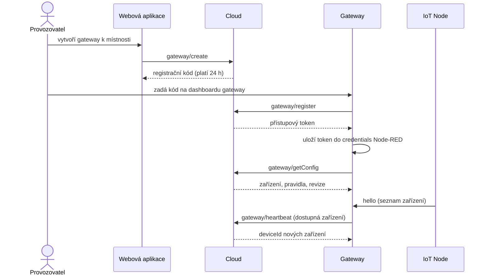
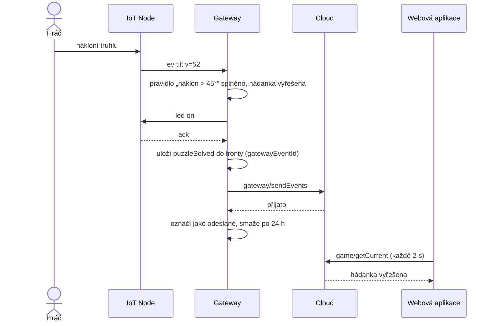
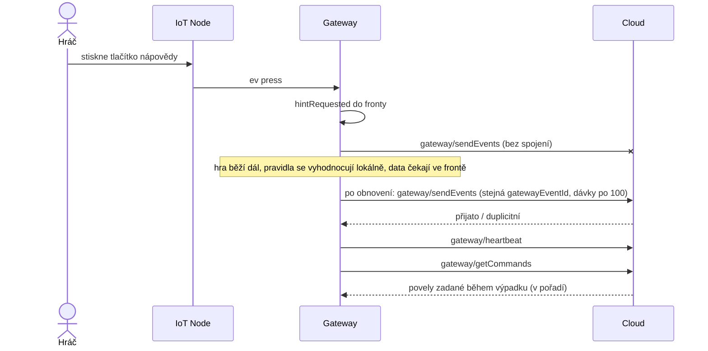

# Komunikace IoT Node ↔ Gateway

> Zdroj pro stránky **BIOT DL Application Model – Tým 1 → IoT Node** a **IoT Gateway** (společná část).
> Firmware nodu popisuje `iot-node.md`, Node-RED flow `iot-gateway.md`, komunikaci gateway s cloudem
> Command List pro gateway (`command-list-gateway.md`).

## Přehled

IoT Node (Arduino Mega 2560) je s gateway (Raspberry Pi 5 s Node-RED) propojený **USB kabelem**,
který slouží zároveň jako napájení i jako sériová linka. Node o hře nic neví: hlásí, co se děje se senzory,
a vykonává povely. Pravidla hádanek, časy událostí a komunikaci s cloudem řeší gateway.

| Směr | Co se posílá |
|---|---|
| node → gateway | ohlášení zařízení (`hello`), události (`ev`), vzorky teploty (`m`), heartbeat nodu (`hb`), potvrzení povelu (`ack`), chyby (`err`) |
| gateway → node | nastavení LED (`led`), reset do výchozího stavu (`reset`), žádost o ohlášení (`who`) |

## 1. Fyzická vrstva

| Parametr | Hodnota |
|---|---|
| Rozhraní | USB (na Arduinu převodník USB ↔ UART), na RPi zařízení `/dev/ttyACM0` |
| Rychlost | **115 200 Bd**, 8 datových bitů, bez parity, 1 stop bit (8N1) |
| Kódování | ASCII / UTF-8 |
| Rámec | **jedna zpráva = jeden řádek** ukončený `\n` (gateway toleruje i `\r\n`) |
| Formát zprávy | JSON objekt na jednom řádku („JSON Lines“) |
| Max. délka | node → gateway 256 B, gateway → node **64 B** (velikost vstupního bufferu Arduina) |

**Proč JSON na řádek:** Node-RED zprávu rozparsuje jedním uzlem (`json`), formát je čitelný při ladění
v sériovém monitoru a nové typy zpráv nebo atributy se dají přidat, aniž by se rozbily stávající.
Arduino používá knihovnu ArduinoJson. Krátké klíče (`t`, `id`, `e`, `v`) šetří délku zpráv.

**Pozor na reset při otevření portu.** Arduino Mega se restartuje pokaždé, když gateway otevře sériový port
(signál DTR). Gateway proto po otevření portu čeká na zprávu `hello`. Když do 3 s nepřijde, pošle `who`.

## 2. Identifikace zařízení

Každý node má v firmwaru konstantu `NODE_ID` (např. `node1`). Zařízení na nodu mají `hwId` ve tvaru
**`<NODE_ID>.<zařízení>`**, takže jsou unikátní v celé místnosti i při více nodech (požadavek `gateway/heartbeat`).

| `hwId` | Typ | Události / povely |
|---|---|---|
| `node1.btn1` | `button` | událost `press` |
| `node1.acc1` | `accelerometer` | události `tilt`, `move` |
| `node1.temp1` | `thermometer` | vzorky teploty (`m`) |
| `node1.led1` | `led` | povel `led` |

## 3. Zprávy node → gateway

Každá zpráva nese `t` (typ). Zprávy kromě `hello` nesou `seq`: pořadové číslo od startu nodu (0–65535, pak znovu od 0).
Gateway podle mezery v `seq` pozná ztracený řádek a zaznamená to do diagnostiky. Zprávy se kvůli tomu neopakují:
sériová linka po USB je spolehlivá a ztráta je výjimečná.

**Čas vzniku** přiděluje gateway při přijetí řádku. Node nemá hodiny reálného času a zpoždění USB je v řádu milisekund.

### hello – ohlášení zařízení

Po startu nodu a jako odpověď na `who`.

```json
{"t":"hello","node":"node1","fw":"1.0.0","devices":[{"id":"node1.btn1","type":"button"},{"id":"node1.acc1","type":"accelerometer"},{"id":"node1.temp1","type":"thermometer"},{"id":"node1.led1","type":"led"}]}
```

Gateway podle `hello` sestaví seznam dostupných zařízení pro `gateway/heartbeat`.

### ev – událost

| Událost | Příklad | Kdy ji node pošle |
|---|---|---|
| `press` | `{"t":"ev","id":"node1.btn1","e":"press","seq":42}` | stisk tlačítka po ošetření zákmitů (30 ms); uvolnění se nehlásí |
| `tilt` | `{"t":"ev","id":"node1.acc1","e":"tilt","v":52,"seq":43}` | náklon (0–180° od svislé osy) se od poslední odeslané hodnoty změnil aspoň o **5°**; nejvýš 5× za sekundu |
| `move` | `{"t":"ev","id":"node1.acc1","e":"move","seq":44}` | zrychlení se odchýlí od klidové hodnoty (1 g) o víc než 0,3 g; poté 1 s pauza |

Prahy jako „náklon > 45°“ vyhodnocuje **gateway** podle pravidel hádanky. Node proto posílá změny náklonu průběžně.
Pásmo 5° zabrání tomu, aby šum akcelerometru kolem jedné hodnoty zaplavil linku zprávami.

### m – vzorek teploty

```json
{"t":"m","id":"node1.temp1","v":23.4,"seq":45}
```

Každých **10 s**, teplota ve °C s přesností na 0,1. Gateway vzorek použije okamžitě pro pravidla
a zároveň ho započítá do downsamplingu (kapitola 6).

### hb – heartbeat nodu

```json
{"t":"hb","node":"node1","up":3600,"seq":46}
```

Každých **5 s**, `up` = sekundy od startu. Když gateway od nodu 15 s nic nepřijme, považuje ho za odpojený
a jeho zařízení přestane hlásit v `gateway/heartbeat`. Tlačítko, které nikdo nemačká, tak zůstává online.

### ack – potvrzení povelu

```json
{"t":"ack","cid":"17","ok":true,"seq":47}
{"t":"ack","cid":"18","ok":false,"err":"unknownDevice","seq":48}
```

### err – chyba nodu

```json
{"t":"err","id":"node1.acc1","code":"sensorNotResponding","seq":49}
```

| `code` | Význam |
|---|---|
| `sensorNotResponding` | senzor neodpovídá (např. GY-521 na sběrnici I2C) |
| `sensorOutOfRange` | hodnota mimo fyzikální rozsah (např. rozpojený termistor) |
| `badMessage` | povel od gateway nešel přečíst (neplatný JSON nebo moc dlouhý řádek) |

Gateway chyby zobrazuje na dashboardu.

## 4. Zprávy gateway → node

Každý povel nese `cid`: identifikátor povelu, který gateway přiděluje (počítadlo, nejvýš 8 znaků).
Node odpoví `ack` se stejným `cid` do 100 ms.

| Povel | Příklad | Co node udělá |
|---|---|---|
| `led` | `{"t":"led","cid":"17","id":"node1.led1","s":"on"}` | nastaví LED na `on`, `off` nebo `blink` (1 Hz) |
| `reset` | `{"t":"reset","cid":"18"}` | zhasne všechny LED a vynuluje vnitřní stav (referenci náklonu); senzory dál měří |
| `who` | `{"t":"who","cid":"19"}` | pošle `hello` |

**Všechny povely nastavují absolutní stav** („LED zapnout“, ne „LED přepnout“). Když stejný povel přijde dvakrát,
výsledek je stejný. Díky tomu node nemusí hlídat duplicity, i když gateway povel zopakuje
(požadavek doručení „alespoň jednou“ z Command Listu pro gateway).

**Opakování:** když `ack` nepřijde do 500 ms, gateway povel zopakuje, nejvýš 3×. Pak závadu zobrazí na dashboardu
a nahlásí ji v heartbeat jako nedostupné zařízení.

Povely z cloudu (`gatewayCommand`) gateway nepřeposílá nodu přímo. Překládá je na povely nodu:
`resetRoom` → `reset`, `solvePuzzle` s akcemi hádanky → odpovídající `led`.
Akce pravidel vyhodnocených na gateway vedou také na `led`.

## 5. Chybové stavy

| Situace | Chování |
|---|---|
| Node pošle neplatný JSON nebo neznámé `t` | gateway řádek zahodí a započítá do diagnostiky |
| Gateway pošle neplatný povel | node pošle `err` s `badMessage` |
| Povel na neznámé zařízení | node pošle `ack` s `ok:false` a `err:"unknownDevice"` |
| Řádek delší než limit | příjemce zahazuje znaky až do nejbližšího `\n` |
| Odpojený USB kabel | gateway přestane dostávat `hb`, po 15 s označí node za odpojený, port otevírá znovu každých 5 s |
| Restart nodu | node pošle `hello`; gateway mu podle stavu hry znovu nastaví LED |

Neznámé atributy v jinak platné zprávě obě strany ignorují. Firmware a flow tak lze aktualizovat nezávisle.

## 6. Downsampling teploty

| Parametr | Hodnota |
|---|---|
| Vzorkování na nodu | každých 10 s |
| Okno | 5 minut, zarovnané na celé pětiminutové úseky UTC, interval `[windowStart, windowEnd)` |
| Agregace | **medián** vzorků v okně (při plném okně 30 vzorků) |
| Odesílá se | `value`, `sampleCount`, `windowStart`, `windowEnd` (`gateway/sendMeasurements`) |
| Okno bez vzorků | záznam nevzniká |

**Proč medián.** Teplotu v místnosti zkreslují krátké výkyvy: hráč vezme předmět s teploměrem do ruky,
nebo jedno měření termistoru ujede kvůli rušení. Průměr se jedním takovým výkyvem posune, medián ho ignoruje,
dokud tvoří menšinu okna. Pro přehled teploty místnosti je důležitá typická hodnota, ne jednotlivé špičky.

**Proč 5 minut.** Teplota místnosti se mění pomalu, takže z jedné hodnoty za 5 minut je trend dobře vidět.
Do cloudu jde 288 záznamů denně místo 8 640, tedy 30× méně dat a zápisů do databáze s omezenou kapacitou.

**Pravidla hádanek downsampling nepoužívají.** Podmínka typu „teplota > 30 °C“ se vyhodnocuje
z každého vzorku hned, aby hráč dostal okamžitou odezvu.

## 7. Retence dat na gateway

| Data | Retence | Zdůvodnění |
|---|---|---|
| neodeslané události a měření | **neomezeně** | požadavek zadání: při výpadku se data nesmí ztratit |
| odeslané (cloudem potvrzené) události a měření | **24 h** | stačí k dohledání problému ze stejného herního dne (porovnání s cloudem při reklamaci hry); pak už jsou data jen v cloudu |
| ID zpracovaných povelů z cloudu | 7 dní | stejně dlouho, jako je cloud drží (`gatewayCommand`), aby se povel neprovedl dvakrát |

Odhad velikosti za 24 h: asi 2 000 událostí po 200 B a 288 měření, celkem pod 1 MB. Úložiště RPi to unese
bez problémů a odeslaná data se mažou průběžně (jednou za hodinu), takže fronta nenarůstá.

## 8. Sekvenční diagramy

### Registrace gateway



### Vyřešení hádanky náklonem



### Výpadek internetu



## Shrnutí rozhodnutí

| Téma | Rozhodnutí |
|---|---|
| Formát | JSON na řádek, 115 200 Bd |
| Identifikace | `hwId` = `<NODE_ID>.<zařízení>` |
| Čas události | přiděluje gateway při přijetí |
| Živost nodu | `hb` každých 5 s, odpojený po 15 s ticha |
| Povely | absolutní stav, `cid` + `ack`, až 3 opakování |
| Downsampling | medián za 5 min (UTC okna), z 10s vzorků |
| Retence na gateway | neodeslané neomezeně, odeslané 24 h |
