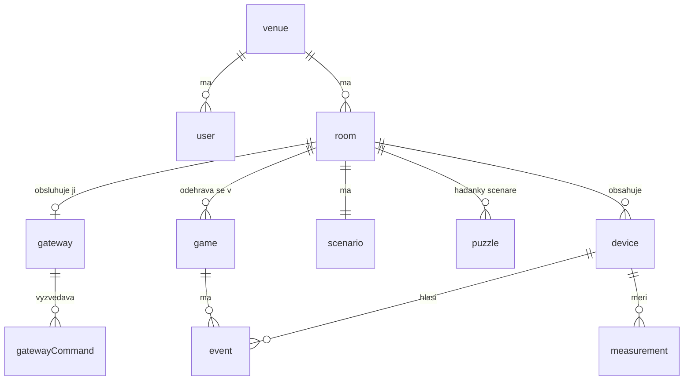

# Persistence Layer

> Zdroj pro stránku **BIOT DL Application Model – Tým 1 → Persistence Layer**.
> Databáze: **MongoDB Atlas** (free tier, 512 MB), přístup přes knihovnu **Mongoose**.
> Commandy nad tímto modelem jsou v [`command-list-webapp.md`](command-list-webapp.md).

## Principy návrhu

- **Co je vnořené a co samostatné.** Vnořuje se to, co se čte vždy s rodičem a nemá vlastní život: pravidla
  v hádance (`puzzle.ruleList`), stavy hádanek ve hře (`game.puzzleStateList`). Samostatná kolekce je to,
  co průběžně přibývá nebo se dotazuje zvlášť: události, měření, hry.
- **Oddělení provozoven.** Každý dokument nese `venueId` (kromě `venue`), takže každý dotaz jde omezit na provozovnu volajícího.
- **Snímek ve hře.** Hra si kopíruje názvy hádanek a časový limit. Pozdější změna scénáře historii nezmění.
- **Bezpečné opakování.** Gateway po výpadku odesílá data znovu a odpověď se může ztratit. Záznam proto musí jít
  poslat vícekrát, aniž by vznikl dvakrát (unikátní indexy u `event` a `measurement`).
- **Tajné hodnoty jen jako hash.** Heslo, registrační kód ani token gateway se v čitelné podobě neukládají.

Každý dokument má navíc `_id` (ObjectId, v API jako `id`), `createdAt` a `updatedAt` (Mongoose `timestamps`).
V cloudu je `createdAt` čas **přijetí**, `occurredAt` je čas **vzniku** na gateway.

## Schema Diagram

Hádanka odkazuje na scénář přes `roomId`: místnost má právě jeden scénář a všechny commandy pracují s `roomId`,
takže další odkaz (`scenarioId`) by byl jen duplicita.

## Schema

„Pov.“ = povinný atribut. Odkazy (`…Id`) jsou ObjectId.

### venue – provozovna

| Atribut | Typ | Pov. | Popis |
|---|---|:-:|---|
| `name` | string (1–100) | ano | název provozovny |

### user – uživatel webové aplikace

| Atribut | Typ | Pov. | Popis |
|---|---|:-:|---|
| `venueId` | ObjectId | ano | provozovna |
| `email` | string | ano | přihlašovací e-mail, malými písmeny |
| `passwordHash` | string | ano | hash hesla (bcrypt) |
| `name` | string (1–100) | ano | jméno |
| `role` | `operator` \| `gameMaster` | ano | určuje profil |

Indexy: `{ email: 1 }` unikátní.

### gateway

| Atribut | Typ | Pov. | Popis |
|---|---|:-:|---|
| `venueId` | ObjectId | ano | provozovna |
| `roomId` | ObjectId | ano | obsluhovaná místnost (jediný zdroj vazby 1:1) |
| `name` | string (1–100) | ano | např. „RPi Pirát“ |
| `state` | `pending` \| `active` \| `revoked` | ano | čeká na registraci / aktivní / zablokovaná |
| `registrationCodeHash` | string | ne | hash jednorázového kódu, po registraci se smaže |
| `registrationCodeExpiresAt` | date | ne | platnost kódu |
| `tokenHash` | string | ne | hash přístupového tokenu |
| `lastSeenAt` | date | ne | poslední kontakt; `online`, pokud není starší než 60 s |
| `syncedScenarioRevision` | integer | ne | revize pravidel, kterou gateway v heartbeatu hlásí jako skutečně uloženou |

Indexy: `{ roomId: 1 }` unikátní; `{ tokenHash: 1 }` unikátní, částečný (jen kde existuje).

### room – místnost

| Atribut | Typ | Pov. | Popis |
|---|---|:-:|---|
| `venueId` | ObjectId | ano | provozovna |
| `name` | string (1–100) | ano | název |
| `description` | string (0–1000) | ne | popis |
| `currentGameId` | ObjectId | ne | aktuální hra; zrychluje polling `game/getCurrent` |

Indexy: `{ venueId: 1, name: 1 }` unikátní.

### device – zařízení

| Atribut | Typ | Pov. | Popis |
|---|---|:-:|---|
| `venueId` | ObjectId | ano | provozovna |
| `roomId` | ObjectId | ano | místnost; při výměně gateway zařízení i pravidla zůstanou |
| `hwId` | string (1–30) | ano | označení z firmwaru, např. `btn1`; unikátní i při více nodech v místnosti |
| `type` | `button` \| `accelerometer` \| `thermometer` \| `led` | ano | typ z pevného katalogu |
| `name` | string (1–100) | ano | srozumitelný název; výchozí hodnota je `hwId` |
| `lastSeenAt` | date | ne | poslední hlášení, aktualizuje ho i **heartbeat** |
| `lastValue` | `{ event, value }` | ne | poslední hodnota |

Indexy: `{ roomId: 1, hwId: 1 }` unikátní; `{ roomId: 1, name: 1 }` unikátní.

### scenario – scénář

| Atribut | Typ | Pov. | Popis |
|---|---|:-:|---|
| `venueId` | ObjectId | ano | provozovna |
| `roomId` | ObjectId | ano | místnost |
| `timeLimitMin` | integer (5–240) | ano | časový limit, výchozí 60 |
| `hintDeviceId` | ObjectId | ne | tlačítko pro žádost o nápovědu |
| `revision` | integer | ano | zvyšuje se při každé změně scénáře nebo hádanky |

Indexy: `{ roomId: 1 }` unikátní.

### puzzle – hádanka

| Atribut | Typ | Pov. | Popis |
|---|---|:-:|---|
| `venueId` | ObjectId | ano | provozovna |
| `roomId` | ObjectId | ano | místnost (a tím i její scénář) |
| `name` | string (1–100) | ano | název |
| `description` | string (0–2000) | ne | poznámka pro game mastera |
| `order` | integer (1–50) | ano | pořadí zobrazení |
| `ruleList` | pole pravidel (1–10) | ano | vnořená pravidla |

Pravidlo: `{ trigger: { deviceId, eventType }, condition: { operator, value }, actionList: [{ type, deviceId, state }] }`
(validace viz `ruleType` v Command Listu).

Indexy: `{ roomId: 1, order: 1 }`.

### game – hra

| Atribut | Typ | Pov. | Popis |
|---|---|:-:|---|
| `venueId` | ObjectId | ano | provozovna |
| `roomId` | ObjectId | ano | místnost |
| `scenarioRevision` | integer | ano | revize scénáře v době resetu |
| `state` | `ready` \| `running` \| `paused` \| `completed` \| `expired` \| `terminated` | ano | stav hry |
| `timeLimitMin` | integer | ano | kopie limitu ze scénáře |
| `startedAt`, `pausedAt`, `endedAt` | date | ne | časy průběhu |
| `pausedDurationSec` | integer | ano | součet pauz, výchozí 0 |
| `hintCount` | integer | ano | počet žádostí o nápovědu, výchozí 0 |
| `puzzleStateList` | pole (max. 50) | ano | `{ puzzleId, name, state: unsolved\|solved, solvedAt, solvedBy: gateway\|user }` |

Indexy: `{ roomId: 1 }` unikátní, částečný (jen `state` v `ready`, `running`, `paused`): místnost nemůže mít
dvě rozehrané hry ani při dvojím kliknutí; `{ roomId: 1, createdAt: -1 }` pro historii;
`{ state: 1, startedAt: 1 }` pro hlídání vypršení.

### event – událost

| Atribut | Typ | Pov. | Popis |
|---|---|:-:|---|
| `venueId` | ObjectId | ano | provozovna |
| `roomId` | ObjectId | ano | místnost |
| `gameId` | ObjectId | ne | hra; prázdné, pokud žádná neběží |
| `deviceId`, `puzzleId`, `userId` | ObjectId | ne | kterého zařízení, hádanky nebo uživatele se týká |
| `gatewayEventId` | string (UUID) | ne | id přidělené gateway při vzniku; chrání proti duplicitám |
| `type` | výčet (níže) | ano | typ události |
| `value` | objekt | ne | detail, např. `{ event: "tilt", value: 52 }` nebo důvod ukončení |
| `source` | `gateway` \| `user` \| `system` | ano | původ (`system` = cloud, např. vypršení) |
| `occurredAt` | date | ano | čas vzniku |

`type`: `deviceEvent`, `puzzleSolved`, `hintRequested`, `roomReset`, `gameStarted`, `gamePaused`, `gameResumed`,
`gameCompleted`, `gameExpired`, `gameTerminated`, `puzzleSolvedManually`, `puzzleUnsolved`.

Teplota se jako událost neukládá, do cloudu jde jen jako `measurement`.

Indexy: `{ roomId: 1, gatewayEventId: 1 }` unikátní, částečný (jen kde existuje); `{ gameId: 1, createdAt: 1 }`
pro polling; TTL na `createdAt` (90 dní).

### measurement – měření

| Atribut | Typ | Pov. | Popis |
|---|---|:-:|---|
| `venueId` | ObjectId | ano | provozovna |
| `roomId` | ObjectId | ano | místnost |
| `deviceId` | ObjectId | ano | teploměr |
| `value` | number | ano | agregovaná teplota v °C |
| `sampleCount` | integer | ano | z kolika vzorků hodnota vznikla |
| `windowStart`, `windowEnd` | date | ano | časové okno downsamplingu |

Indexy: `{ deviceId: 1, windowStart: 1 }` unikátní (stejné okno nejde uložit dvakrát); `{ roomId: 1, windowStart: -1 }`;
TTL na `createdAt` (90 dní).

### gatewayCommand – fronta povelů pro gateway

| Atribut | Typ | Pov. | Popis |
|---|---|:-:|---|
| `venueId` | ObjectId | ano | provozovna |
| `gatewayId` | ObjectId | ano | příjemce |
| `type` | výčet | ano | `resetRoom`, `startGame`, `pauseGame`, `resumeGame`, `stopGame`, `solvePuzzle`, `unsolvePuzzle` |
| `payload` | objekt | ne | parametry povelu |
| `state` | `pending` \| `delivered` | ano | `delivered` až po **potvrzení** od gateway |
| `deliveredAt` | date | ne | čas potvrzení |

Indexy: `{ gatewayId: 1, state: 1, createdAt: 1 }`; TTL na `deliveredAt` (7 dní). Nedoručené povely TTL nemaže,
protože nemají `deliveredAt`.

## Retence dat v cloudu

| Data | Retence | Zdůvodnění |
|---|---|---|
| `event` | 90 dní | Detail je potřeba hlavně při řešení závad. Výsledky her zůstávají v `game`. |
| `measurement` | 90 dní | Stačí pro sledování trendu a šetří kapacitu. |
| `gatewayCommand` | 7 dní po doručení | Slouží jen k dohledání problémů s doručením. |
| ostatní | bez omezení | Konfigurace a výsledky her jsou malé a mají trvalou hodnotu. |

Odhad na místnost za 90 dní: měření asi 8 MB (288 záznamů denně), události asi 70 MB (4 hry denně, 500 událostí na hru).
Do limitu 512 MB se tak vejde několik místností, což MVP stačí.

## Limit List

| Limit | Hodnota |
|---|---|
| místností na provozovnu | 50 |
| zařízení v místnosti | 32 |
| hádanek ve scénáři | 50 |
| pravidel v hádance | 10 |
| akcí v pravidle | 5 |
| `timeLimitMin` | 5–240 min |
| platnost registračního kódu | 24 h |
| událostí nebo měření v jednom odeslání z gateway | 100 (větší fronta se posílá po dávkách) |

## DAO Method List

**DAO** je jediná vrstva, která mluví s databází. Každá metoda dostává `venueId`, pokud se volá z webové aplikace.

| DAO | Metody |
|---|---|
| `venueDao` | `create`, `get` |
| `userDao` | `create`, `getByEmail` |
| `gatewayDao` | `create`, `get`, `getByRoom`, `getByTokenHash`, `getByRegistrationCodeHash`, `activate`, `updateLastSeen`, `delete` |
| `roomDao` | `create`, `get`, `list`, `count`, `update`, `setCurrentGame`, `delete` |
| `deviceDao` | `upsertByHwId`, `get`, `listByRoom`, `update`, `updateLastSeen`, `deleteByRoom` |
| `scenarioDao` | `create`, `getByRoom`, `update`, `incrementRevision`, `deleteByRoom` |
| `puzzleDao` | `create`, `get`, `listByRoom`, `countByRoom`, `update`, `delete`, `deleteByRoom` |
| `gameDao` | `create`, `get`, `updateState`, `setPuzzleState`, `incrementHintCount`, `listExpired`, `deleteByRoom` |
| `eventDao` | `create`, `listByGatewayEventIds`, `createWithGameEffect`, `listByGameSince`, `deleteByRoom` |
| `measurementDao` | `insertManyIgnoreDuplicates`, `listByRoom`, `deleteByRoom` |
| `gatewayCommandDao` | `create`, `listPending`, `markDelivered`, `deleteByGateway` |

Poznámky k metodám:

- `gameDao.updateState` podmiňuje zápis očekávaným stavem (`findOneAndUpdate({ _id, state: expected }, …)`),
  takže se dva souběžné zásahy nepřepíšou.
- `eventDao.createWithGameEffect` uloží novou událost a její dopad na hru (např. `hintCount`) v jedné transakci MongoDB,
  takže pád serveru mezi nimi nic neztratí. Událost s už uloženým `gatewayEventId` efekt nezopakuje.
- `measurementDao.insertManyIgnoreDuplicates` používá `insertMany` s `ordered: false`: duplicity odmítne unikátní index
  a zbytek dávky se uloží.
- Záznam se stejným identifikátorem, ale jiným obsahem, není duplicita, ale konflikt (`eventIdConflict`, `measurementConflict`).
